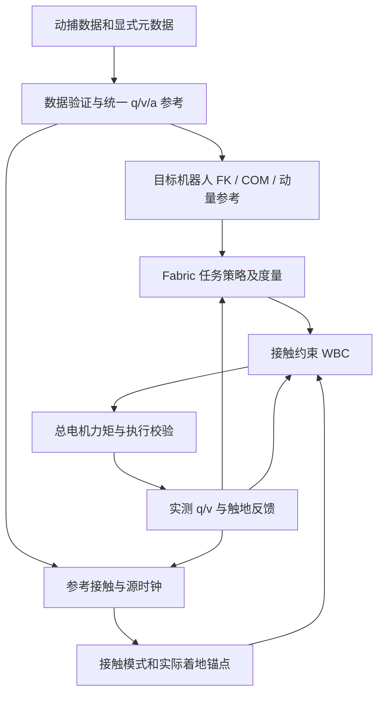

# 重定向动捕 reference + Fabric 任务策略 + 接触约束 WBC

> 2026-10-25预算更正：在线WBC使用0.8倍`unitree_g1_effort_limits()`模拟电机表，不是0.8倍URDF effort。踝关节在线预算为20 N·m，旧离线审计曾用40 N·m。旧章节据URDF预算得出的“力矩通过/与在线对齐”结论已被第36节更正。实际仍0/4步；实时首步预检正确拒绝了超限候选。

核对日期：2026-10-04。本文区分源码事实、离线检查、历史物理试验与拟实施方案。本轮未运行新的闭环物理仿真，未完成整段 tracking。首阶段提供实际可运行的检查工具和全片产物，不新增空控制接口。

## 1. 参考资料与适用边界

- [论文 arXiv:2303.04279](https://arxiv.org/pdf/2303.04279)：任务空间策略、度量、pullback/summation，以及欠驱动全身控制是借鉴依据。本文提出的“动捕参考 + 显式接触约束 QP”是本项目的混合方案，不宣称等同论文实现，也不继承其任意扰动稳定保证。
- 原仓库核对的是 **sim**，固定提交 `cf77ae1b52f5d192b181fe408d91a0e7f7add7ea`，本轮只读副本在 `/tmp/mocap_kinofabs_sim`，没有修改它。
- [types.jl](https://github.com/adubredu/KinodynamicFabrics.jl/blob/cf77ae1b52f5d192b181fe408d91a0e7f7add7ea/src/types.jl)：原机器人为 Digit；列出 24 个内部关节名称、20 个电机名称，广义限位数组包含基座和关节共 30 项。不能将这些索引当作 G1 的 29 关节顺序，也不能等同于 MuJoCo 完整 `nq/nv`。
- [task_maps.jl](https://github.com/adubredu/KinodynamicFabrics.jl/blob/cf77ae1b52f5d192b181fe408d91a0e7f7add7ea/src/task_maps.jl) 的 `walk_task_map` 调用 ALIP 落脚规划；[alip.jl](https://github.com/adubredu/KinodynamicFabrics.jl/blob/cf77ae1b52f5d192b181fe408d91a0e7f7add7ea/src/alip.jl) 的 `compute_virtual_constraint` 输出四个目标分量，前三项为摆脚路径，第四项固定为 0.92。它不是通用动捕全身轨迹加载器。
- [kinofabrics.jl](https://github.com/adubredu/KinodynamicFabrics.jl/blob/cf77ae1b52f5d192b181fe408d91a0e7f7add7ea/src/kinofabrics.jl) 聚合任务度量和策略后求加速度，再调用 `integrate`；[utils.jl](https://github.com/adubredu/KinodynamicFabrics.jl/blob/cf77ae1b52f5d192b181fe408d91a0e7f7add7ea/src/utils.jl) 的 WalkingMode 使用特殊增益及局部 Δt=1，手臂另乘 0.1。其低层命令转换不能照搬成本项目的物理积分。
- 原 `qp.jl` 的 `initialize_solver` 建立速度变量；不能因原仓库有 QP 文件，就声称已有本文拟议的加速度/力矩/接触力联合 WBC。

## 2. 本地实际入口与已核实事实

路径相对仓库根目录；本地存在大量前期实验分支，以下事实来自源码核对，而非把历史笔记当成实现保证。

| 部分 | 实际文件/符号 | 已核实行为及边界 |
|---|---|---|
| 物理控制入口 | `examples/test_g1.py::main` | Isaac Sim；由 `G1_USD_PATH.stem` 选择匹配 URDF，支持 unified/legacy-managed 等多种路径，不能混为单一默认算法 |
| 机器人模型 | `src/fabrics_sim/models/robots/urdf/g1/g1_29dof_rev_1_0.urdf`；`fabrics/g1_pose_fabric.py` | 本轮按 rev_1_0 检查；29 个驱动关节，配置 q 为 36 维（XYZ+xyzw+29），速度/加速度为 35 维（基座6+29） |
| 数据加载/顺序 | `examples/test_g1_two_tasks.py::G1_JOINT_NAMES, load_motion_trajectory, load_motion_contact_sequence` | 读取 root_pos/root_rot/dof_pos，存在 dof_names 时按名称重排，否则直接假定规范顺序；归一化 xyzw 四元数；缺 fps 时默认为 30；接触列预期 left/right |
| 本地导出器 | `retarget/retargeting/export.py::export_robot_pkl` | 按 URDF 轴投影角度，写 xyzw、dof_names、fps 与几何推断接触。不能证明当前旧 walk1 文件由这一版本导出 |
| 插值 | `reference/interpolation.py::MotionInterpolator` | 四元数符号展开与归一化，解析世界坐标角速度/加速度；PCHIP 为 C1，**不是 C2**，节点加速度可能跳变；可选 cubic 存在过冲风险 |
| 全身参考 | `reference/whole_body.py::WholeBodyReference` | 用同一个 q/v/a 生成任务目标，接触锚点独立；运动学一致不等于动力学可行 |
| 参考接触管理 | `reference/manager.py::ReferenceManager` | 参考事件、载荷/平衡门限、等待和超时；当前不支持任意飞行标签，模式0需要明确处理 |
| 真实接触检测 | `solver/dynamic_consistent_gpu.py::BatchedFootContactDetector`；`test_g1.py` | 从实测足端法向力判断接触；`solver/contact_patches.py`、`observed_sole_contact.py` 处理实测接触点/部分支撑，锚点不能每帧追着源脚移动 |
| 质量/质心/动量 | `taskmaps/g1_centroidal_momentum.py::G1CentroidalModel` | 共享 URDF FK，使用各连杆惯性原点和质量计算 COM、雅可比、角动量矩阵及质量矩阵 |
| 实际动力学 | `test_g1.py::read_isaac_dynamics`、`solver/rigid_body_frames.py` | 读取 Isaac 动力学并处理根坐标原点/COM、速度顺序转换；有质量矩阵交叉检查和 motor armature 路径 |
| Fabric任务意图 | `fabrics/dynamics_aware.py::DynamicsAwareTasks`、`fabrics/task_request.py::TaskRequest` | 已有 COM、身体、足端、手部、动量及碰撞等任务；请求含 A、bias、desired、metric、active。描述性 priority 字段本身不保证严格优先级 |
| WBC | `solver/AccelerationQP.py` | 76 个变量：35 加速度+12 两足六维 wrench+29 力矩；动力学前6行包含浮动基座，未把基座加速度固定为零。非接触足 wrench 清零；摩擦、力矩及加速度等约束随配置加入 |
| 力矩出口 | `test_g1.py` 中 `robot.set_joint_efforts` | 当前下发的是前馈加显式反馈后的限幅总力矩；`--direct-wbc` 仍可能含速度阻尼/跟踪伺服，不能称为无条件直接下发纯 QP τ |

## 3. 目标架构（改造约定，不是完成声明）



- 名义落脚位置、摆脚路径首先来自 reference。不要把 ALIP 或本地实验性 LIPM/优化 COM 预览悄悄作为必需主链；若后续引入适配，必须记录原始与适配参考、改变量和源时钟。
- 支撑脚约束使用实测着地锚点。源脚的滑动不能直接驱动支撑锚点滑动；部分脚掌接触应有对应的可约束方向，不能无条件施加六维平足约束。
- 原始动作、平滑参考、接触适配参考、实际状态分别保存。统一 FK 生成足端、躯干、手部和质量加权 COM；COM 不可直接拿 root_pos 替代。
- 任务建议：COM 位置/速度反馈；摆脚 SE(3) 或可配置位置任务；躯干 SO(3)；软关节姿态；按动作启用手部。角动量参考应由全身动作计算，不能对所有摆臂动作强制零动量。
- WBC 的物理形式为 `M(q)a+h(q,v)=Sᵀτ+Jcᵀλ`，接触为 `Jc a+Jdot_c v=a_contact`，再施加摩擦/压力中心/法向载荷、关节力矩和速度/制动限制。浮动基座6维 a 始终参与优化。
- Fabric 的加速度意图和度量通过 `TaskRequest` 映射为软目标，而不是只保留一个标量 PD 权重。必须核对已有目标聚合与严格优先级路径，避免身体和摆脚互相挤占。
- 执行端只发力矩。若保留阻尼/伺服，须把**总力矩**及其对应的预测加速度纳入 WBC，避免求解后加反馈再裁剪导致约束失效；不复制 Julia 的特殊 qdes 转换。
- 扰动稳定性范围单独定义。先使用 COM/速度与动量反馈，在接触或可行性丢失时停止/恢复；之后才评估有界落脚、步时调整。固定参考不能保证任意扰动可恢复。

## 4. 首阶段交付与实际检查结果

已实现 `examples/inspect_mocap_reference.py`，执行方式（输出目录必须不存在）：

```bash
PYTHONPATH=src:examples:.runtime/qp_solvers OMP_NUM_THREADS=1 OPENBLAS_NUM_THREADS=1 \
/home/sky/anaconda3/envs/humanoid_fabric/bin/python examples/inspect_mocap_reference.py \
  retarget/lafan/walk1_g1.pkl \
  --contacts-pkl retarget/lafan/walk1_g1_with_contacts.pkl \
  --output-dir acc_data/mocap_reference_new_audit
```

输入为可信本地 pickle。工具不修改源文件，不启动物理仿真。逐帧检查有限值、四元数、URDF关节映射和限位，按目标模型计算足端/躯干/手部/COM，输出当前解析 PCHIP 速度与加速度。对接触副本要求 q 与 fps 一致；若无标签，只生成明确标为 provisional 的高度/速度候选，不冒充实测触地。

本轮运行产物在 `acc_data/mocap_reference_audit_complete_20261004/`：

- [report.json](../acc_data/mocap_reference_audit_complete_20261004/report.json)：元数据、源/URDF SHA256、完整29关节映射、接触段与指标。
- [overview.png](../acc_data/mocap_reference_audit_complete_20261004/overview.png)：世界 XY 轨迹、足端高度/速度、接触时序、COM/root 高度与限位。
- [poses.png](../acc_data/mocap_reference_audit_complete_20261004/poses.png)：六个时刻的 URDF 骨架与 COM；不是网格碰撞检查或仿真截图。
- `reference_geometry.npz`：时间、原始归一化 q、解析 v/a、足端和近似足底点、COM、躯干/手部位置、接触标签等。
- FK 独立实现与现有 `G1CentroidalModel` 在帧 0、114、129、3919、7838 对照：选定足/手/躯干位置最大误差 < 0.9 μm，COM < 0.5 μm。记录在 `acc_data/mocap_reference_audit_20261004/fk_crosscheck.json`。这是模型内部一致性，不证明源文件关节顺序正确。

| 检查项 | 本次实测/结论 |
|---|---|
| 数据规模 | 7839帧，30Hz，首末样本跨度261.2667s；q=36、v=35 |
| 模型质量 | 当前URDF总质量33.34114202kg，不代表硬件称重 |
| 原文件字段 | root_pos、root_rot、dof_pos、fps、link_body_list、local_body_pos；**没有 dof_names、contact_sequence 和显式单位/坐标声明** |
| 关节顺序 | 暂用加载器29关节顺序，未由源元数据证实。完整顺序及源列状态写入JSON；不能因FK看起来合理就宣称核实完成 |
| 坐标和单位 | 代码使用世界XYZ、Z向上、xyzw、米、弧度；旧文件缺少这些声明，绝对朝向/原点和生成链仍待追溯 |
| 四元数 | 原范数约1；归一化检查不能证明xyzw排列 |
| 关节位置限位 | 按当前映射，全部样本无位置越界；不代表速度、加速度或动力学可行 |
| PCHIP导数 | 有限；峰值关节速度28.3426rad/s，加速度1021.8106rad/s²。C1插值不能保证平滑加速度，需检查节点、接触边界与时间缩放 |
| 标签来源 | 匹配动作副本中的left/right标签，不是测力真值；模式0/左/右/双支撑帧数为0/2639/2566/2634 |
| 左足标签期间 | 近似足底点水平速度P95=0.408m/s；接触段最大相对起点位移0.143m |
| 右足标签期间 | 对应P95=0.383m/s；最大段内位移0.184m |
| 标签与高度 | 估计地面z=0.00243m；标签有效但最低近似足底角高于地面3cm：左238帧、右155帧 |

滑动统计使用踝坐标系下 `[0,0,-0.035]m` 的足底代理点；地面取全片近似足底最低角高度的1%分位数。标签边界、脚掌滚动、模型脚底近似、地面估计和重定向误差都可能产生位移。因此上述量是**参考接触不一致的筛查证据**，不是实测摩擦滑移。所有原始坐标保留，未自动把脚投影到地面，也未调整源落脚目标。

## 5. 未决问题与进入控制阶段的门槛

1. 追溯旧 walk1 的实际导出器/映射；`link_body_list` 不是天然的 DOF 顺序。确认四元数排列、米/弧度、世界轴与根链原点，并保存版本化元数据。不足以确认时，明确使用“假定映射”，不能悄悄写成已认证。
2. 对最长接触段滑动和高脚底标签抽样复核；区分脚尖滚动与支撑脚滑动，设计标签置信度和边界滞回。标签推断不得用实际控制成功反推其一定正确。
3. 检查 PCHIP 加速度峰值是否集中于结点/极快关节运动；比较有界 C2 平滑与时间重定标，同时重新检查关节限位、脚轨迹和接触时序。不能只把 fps 改小而不同步修改所有导数。
4. 确认 URDF/USD/重定向模型版本一致，复核惯性与armature、基座原点/COM以及Isaac自由度重排；实时接触力与模型接触方向保持同一坐标约定。
5. 已有历史站立/首次抬脚通过记录，但最近名义首步与避碰参考冲突；实测上肢候选虽清除碰撞违规，仍有踝关节制动违规。不要把这些实验适配拼接成已完成的通用框架。
6. 尚未验证真实控制实时性。500Hz仿真更新频率不等于每次求解耗时小于2ms，更不等于已部署硬件。

## 6. 分阶段实施与验收

| 阶段 | 工作 | 进入下一阶段前的证据 |
|---|---|---|
| A：数据检查（本轮） | 实现并运行检查/可视化，生成可追溯元数据、FK和接触诊断 | 本轮已交付运行产物；源顺序/单位缺口仍保留，不能标为全部认证完成 |
| B：参考规范化 | 形成显式数据契约；提供 q/v/a 与各任务参考；原始与适配版本分离 | 全片有限值/限位/导数检查；模型一致性；接触边界与平滑误差报告 |
| C：统一接触管理 | 参考事件+触地反馈、支撑锚点、早触地/延迟/重复同侧/双支撑；明确飞行范围 | 单独站立、承重转移、抬脚放回；实测接触和稳态指标，超时/失载明确失败 |
| D：Fabric任务与WBC收敛 | 复用已实现TaskRequest和76变量QP；梳理任务与物理加速度映射，去掉相互覆盖的实验分支 | 动力学、接触和总力矩残差；任务消融；浮动基座六维不被错误冻结 |
| E：原始单步到多步 | 原始落脚/摆脚为名义输入，针对实际起点规划连续接入与可行制动 | 完整起落脚、停止和双支撑；对原始PKL误差、接触确认、完整控制有效性同时通过 |
| F：全文件及扰动 | 原始时间与重定时时间分别记录；覆盖最后帧及稳定尾段；有界扰动试验 | 明确误差门槛、无跳帧/重置、原始与适配偏差；失败记录与恢复边界；再评估落脚/步时调整 |

本轮新增测试 `tests/test_mocap_reference_audit.py` 验证带旋转关节和固定偏置的FK/质量质心、错误名称拒绝以及接触段统计不跨摆动拼接。已实际执行2项测试，并运行上述五帧真实G1几何对照。既有物理控制代码在本轮未修改，控制阶段没有新增通过声明。

## 7. 参考规范化进展：显式 C2 候选

新增可选 `MotionInterpolator(method="bspline")`，默认 PCHIP 不变。夹持三次
B样条以原采样姿态作为控制点，标量关节轨迹保持控制点凸包范围，内部为 C2；
它**不穿过所有原始采样点**。四元数仍先符号展开再归一化。

可执行入口：

```bash
PYTHONPATH=src:examples OMP_NUM_THREADS=1 OPENBLAS_NUM_THREADS=1 \
/home/sky/anaconda3/envs/humanoid_fabric/bin/python examples/prepare_mocap_reference.py \
  retarget/lafan/walk1_g1.pkl \
  --contacts-pkl retarget/lafan/walk1_g1_with_contacts.pkl \
  --joint-acceleration-cap 50 \
  --output-dir acc_data/walk1_c2_new_candidate
```

这里的50 rad/s²是明确的离线规划上限，不是硬件认证加速度限值，也不替代状态
相关的关节制动约束。工具用每段三次多项式的一阶导数极值和二阶导数端点，
计算整个连续标量关节轨迹的速度/加速度峰值，再统一缩放时间；不是仅检查30Hz采样。
URDF速度限值同时参与缩放。接触标签保持源帧关联，时刻随时间一起缩放；
平滑后接触几何尚未重新认证。

实测产物：`acc_data/walk1_c2_reference_contacts_20261004/` 的 `candidate.npz`、
`report.json`、`comparison.png`。全片7839帧，速度比例0.242484，时长1077.46s；
重定时后连续关节速度峰值6.872rad/s，加速度峰值50rad/s²。
源采样帧处最大单关节变化0.07881rad，峰值逐帧关节RMSE 0.02603rad，
左右足位置偏差最大10.10/9.70mm，COM偏差最大1.66mm。
这些几何误差只在源采样帧统计，不能解释为区间内严格误差上界。

NPZ同时保存源q、候选q/v/a、源帧、重定时时刻、接触标签及原样条系数。
不得把候选采样点再作为B样条控制点进行第二次平滑，否则会改变曲线。
端点可能有非零速度，启动/停止和变速区间仍须按链式法则连接。
当前只是可运行、可审计的参考候选；物理控制输入尚未改用该候选。
尚未通过接触/力矩/碰撞/关节制动或闭环验证，也未解决源关节名和单位缺失。

新增平滑、导数、短片段、四元数符号与时间缩放测试；与既有插值、FK检查合计15项通过。

## 8. C2 候选的接触与动力学预检查

新增可执行 `examples/audit_mocap_dynamics.py`，读取准备好的 q/v/a 和接触标签，
复用 G1 质量模型、运行时足底 wrench 锥和关节制动/碰撞屏障。它固定候选加速度，
通过线性规划分配两足 wrench 并最小化峰值电机力矩比例；非接触脚的 wrench
严格置零。浮动基座六维动力学用于力平衡，未固定基座加速度。

```bash
PYTHONPATH=src:examples:.runtime/qp_solvers OMP_NUM_THREADS=1 OPENBLAS_NUM_THREADS=1 \
/home/sky/anaconda3/envs/humanoid_fabric/bin/python examples/audit_mocap_dynamics.py \
  acc_data/walk1_c2_reference_contacts_20261004/candidate.npz \
  --stride 30 --output acc_data/walk1_c2_dynamics_new.json
```

默认每30个源帧抽样，并包含每个标签切换的前一帧、切换帧及最后帧。
本次已执行1454个样本，结果在 `acc_data/walk1_c2_dynamics_20261004.json`。
输出非零退出码表示候选被拒绝，不代表检查器未完成。

| 不通过项 | 样本数（可重叠） |
|---|---:|
| 标记支撑脚的速度/加速度不满足刚性固定接触 | 1454 |
| 接触力分配不可行或峰值力矩比例超过1 | 847 |
| 关节制动违规或允许加速度区间为空 | 588 |
| 运行时覆盖球碰撞屏障违规 | 1422 |

接触检查对六维各分量分别使用1e-3阈值，线性项单位m/s、m/s²，角项rad/s、rad/s²。
这不是足底真实滑动或冲击模型；脚掌滚动/部分接触仍需相应接触子空间。
源帧114的左脚支撑速度最大分量0.00440，加速度最大分量0.0888，且给定候选
加速度的单支撑 wrench 分配不可行；源帧129双支撑分配的峰值力矩比例约0.195，
但接触运动仍不相容。仅看力矩比例会漏掉后者。

**这些是精确执行给定 q/v/a 的必要条件，不能推出软任务 WBC 无法跟踪。**
WBC可偏离参考满足约束，但必须记录实际偏差、支撑锚点和失效边界。
覆盖球违规也不等于真实网格穿透。该报告是全片范围的抽样，不是逐500Hz
连续时间证明，更不是物理仿真通过证书。

下一阶段的首要任务是将支撑参考与实际着地锚点协调：保留源摆脚目标，
支撑脚不追随源脚滑动；必要的全身适配需同时检查接触、质心、上肢避碰和
关节制动。不能继续单独降低速度并把它视为可执行参考。
本轮未把候选下发物理控制。新增接触力分配测试检查浮动基座平衡、悬空脚
不能承重、力矩超限和无支撑拒绝；与平滑及插值测试合计16项通过。

## 9. 固定实测支撑锚点的全身参考投影

新增 `reference/anchored_reference.py::anchor_reference`，使用明确传入的实测足端
锚点和固定接触掩码。支撑足位姿替换为锚点、其目标速度/加速度置零，摆脚目标
及 COM 目标保留；姿态 IK 后通过同一全身雅可比求解 v，再计入 Jdot*v 求 a。
骨盆姿态和上肢沿用输入参考，不固定浮动基座平移。可选 IK warm-start 只影响
求解初值，不改变目标、精度或关节限位。该模块只生成参考，不修改实际机器人状态。

可运行入口：

```bash
PYTHONPATH=src:examples:.runtime/qp_solvers OMP_NUM_THREADS=1 OPENBLAS_NUM_THREADS=1 \
/home/sky/anaconda3/envs/humanoid_fabric/bin/python examples/project_mocap_contacts.py \
  acc_data/walk1_c2_reference_contacts_20261004/candidate.npz \
  --anchor-recording acc_data/walk1_staged_baseline_v2_20261004/transfer.npz \
  --start-frame 114 --end-frame 128 --output-dir acc_data/walk1_contact_projection_new
```

只接受单个固定接触模式区间。锚点来自该实测记录的最后一帧，要求请求的支撑足
载荷≥20N，并对候选应用记录中的全局 ground shift。这里利用历史锚点做离线
诊断，不是从该记录恢复物理状态，也未验证候选起点与实测 q/v 连续。

本次114–128共15个源采样帧中，14帧投影达到既定精度；128帧的IK剩余残差约
0.303mm，未满足2μm数值求解阈值。前帧 warm-start 重试仍未达到阈值，不能
据此证明全局不存在解。失败帧未被悄悄跳过：进程返回失败，部分结果单独标为
`partial.npz`，报告 `complete_interval=false`，不是可执行完整首步。

记录在 `acc_data/walk1_anchored_first_partial_20261004/`。14帧的支撑足速度和
加速度残差降至数值误差量级，摆脚与COM的保持误差在约1μm内。对这些帧再运行
`audit_mocap_dynamics.py --stride 1`：接触运动违规从14降为0，但力矩/接触力
分配仍有14帧不通过，碰撞14帧不通过，关节制动1帧不通过。
原始源帧编号在审计中保留，不把部分数组下标当作源帧。

进一步复核的所需单支撑足底压力中心：源帧114为(x,y)=(0.0937,-0.0712)m，
帧127为(0.2105,-0.0740)m；当前足底矩形范围为x∈[-0.05,0.12]、
y∈[-0.025,0.025]m。前者横向已经超出足底，后者还超过前缘。
这解释了为何固定脚的运动学约束通过，仍无法精确执行给定 COM/全身加速度。
证据：`acc_data/walk1_anchored_first_wrench_20261004.json`。

下一步需要联合适配 COM/动量参考与上肢避碰，保留源摆脚目标并记录原始PKL偏差；
不能把压力中心强行裁到足底、扩大足底，或放松动力学约束冒充可行。
本轮未运行物理首步。左右支撑投影、导数残差、输入不可变性和接触力分配等
5项针对性测试通过；固定模式的采样验证不证明接触切换或连续区间可行。

## 10. 质心高度对照（2026-10-07）

恢复读取上次中断的实验：局部水平偏移(-0.06,+0.06)m，仅7/15帧达到IK精度。
投影入口现增加显式 `--com-offset-height`（沿固定支撑脚局部Z）；三维总偏移
仍限制在0.15m内。常量世界偏移不增加COM速度/加速度，相关导数测试覆盖垂向偏移。

保持同一水平偏移和候选摆脚目标，降低4cm达到10/15帧；降低8cm为9/15帧，
因此不按“更低更稳”继续盲目调参。4cm的10帧（源114–123）重新审计：接触运动
违规0，力矩/接触力分配违规0，峰值力矩比例0.6203；但关节制动10帧违规，
覆盖球碰撞屏障10帧违规，124–128帧IK仍失败。不能把部分通过宣布为完整首步。
原有足底范围、碰撞保护和制动阈值未放宽，未下发物理控制。

```bash
PYTHONPATH=src:examples:.runtime/qp_solvers OMP_NUM_THREADS=1 OPENBLAS_NUM_THREADS=1 \
/home/sky/anaconda3/envs/humanoid_fabric/bin/python examples/project_mocap_contacts.py \
  acc_data/walk1_c2_reference_contacts_20261004/candidate.npz \
  --anchor-recording acc_data/walk1_staged_baseline_v2_20261004/transfer.npz \
  --start-frame 114 --end-frame 128 --com-offset-local -.06 .06 \
  --com-offset-height -.04 --warm-start --output-dir acc_data/walk1_com_height_new
```

可复查汇总：`acc_data/walk1_com_height_comparison_20261007.json`；动力学证据：
`acc_data/walk1_com_lower_dynamics_20261007.json`。6项投影/力分配测试通过。
这些是源帧采样离线结果，未验证连续轨迹、接触切换、接入段或完整PKL。
下一阶段需联合调整上肢避碰和腿部制动，解决剩余IK帧并与实测状态连续连接。

## 11. 保持实测上肢与骨盆的对照（2026-10-07）

本轮核对工作区已有 `--hold-measured-upper` 及其记录：上肢保持候选10帧可投影，
碰撞违规降为2帧，制动仍10帧违规。增加显式离线选项 `--hold-measured-pelvis`：
在计算源摆脚、COM及其导数目标之后固定实测骨盆四元数，把对应角速度/角加速度
置零，再解腿部和浮动基座平移。它是身体参考适配，不是重置机器人，也不是逐关节
精确重放PKL；默认不启用。原始任务目标仍保留，衔接段尚未规划。

沿用水平偏移(-.06,+.06)m和高度偏移-.04m，联合保持实测上肢/骨盆：15帧中
11帧达到IK精度，124–127帧未通过。该11帧接触运动与力矩/接触力分配均通过，
碰撞屏障仍1帧违规，关节制动11帧违规。缺帧部分保存为 `partial.npz`，绝不可
将123直接连接至128作为可执行轨迹。

```bash
PYTHONPATH=src:examples:.runtime/qp_solvers OMP_NUM_THREADS=1 OPENBLAS_NUM_THREADS=1 \
/home/sky/anaconda3/envs/humanoid_fabric/bin/python examples/project_mocap_contacts.py \
  acc_data/walk1_c2_reference_contacts_20261004/candidate.npz \
  --anchor-recording acc_data/walk1_staged_baseline_v2_20261004/transfer.npz \
  --start-frame 114 --end-frame 128 --com-offset-local -.06 .06 \
  --com-offset-height -.04 --hold-measured-upper --hold-measured-pelvis \
  --warm-start --output-dir acc_data/walk1_held_body_new
```

审计新增逐帧最坏关节的位置、速度、参考加速度、允许加速度区间与位置限位距离。
源114左踝roll：角度0.22237rad，距上限0.03943rad，速度+0.02937rad/s；
参考加速度-0.08649rad/s²，但允许上界为-1.14629rad/s²。当前保护区间保留
0.05rad，此姿态已进入保护区，因此不能假设单独减慢源时钟即可消除冲突。
源123右膝：速度-1.4273rad/s、参考加速度-3.3889rad/s²，允许下界+4.8046rad/s²。
源128独立采样还出现右膝-101.58rad/s²；这不是可执行连续轨迹已通过的证据。

记录：`acc_data/walk1_held_body_20261007/report.json`、
`acc_data/walk1_held_body_joint_audit_20261007.json`。
7项投影与力分配测试通过，包含固定身体、保留摆脚速度/COM、非法四元数拒绝。
当前仍无完整可执行首步，也未运行物理闭环；需要联合姿态与质心优化以保留
踝关节保护余量，并重新验证全段连续性、避碰和落地。现有保护阈值不变。

## 12. Single-entry online pipeline (2026-10-07)

`examples/test_g1.py --mocap-pipeline --motion-pkl ...` now performs preparation
and online execution in one process and one simulation, without an intermediate
NPZ export, a second fitting operation, or restarting the robot between stages.
It selects unified whole-body references, source contact planning, analytic C2
B-spline sampling, and direct WBC effort control. Other existing controller flags
still configure feedback, contact patches and physical model details.

At startup `reference/preprocessing.py::prepare_reference` validates scalar
position limits against the actual controller URDF, constructs the C2 spline,
and caps the requested playback speed using exact polynomial joint derivative
peaks and the explicit planning acceleration cap (default 50 rad/s²). The very
same sampler supplies q/v/a to `WholeBodyReference.apply` in the control loop.
Clock rate and acceleration enter the chain rule. The scalar acceleration cap
is a constant-rate planning bound, not a bound on clock-ramp accelerations or a
certificate of dynamic feasibility. Positive warmup and ramp durations are
required. Original motion poses remain available for fidelity auditing.

Optional `--contacts-pkl` validates companion pose/fps equality and requires
labels. With no labels, the existing sole-corner contact inference is used;
these are inferred labels, not confirmed data metadata. The reference manager
uses measured contact feedback, and the WBC retains actual touchdown anchors,
full floating-base dynamics, joint braking, collision, friction and effort
constraints. The incomplete offline anchored projections are not concatenated
or executed. This integration does not resolve their feasibility failures.

Reproducible short simulation command (extend duration for further evaluation):

```bash
PYTHONPATH=src:examples:.runtime/qp_solvers OMP_NUM_THREADS=1 OPENBLAS_NUM_THREADS=1 MKL_NUM_THREADS=1 \
/home/sky/anaconda3/envs/humanoid_fabric/bin/python examples/test_g1.py \
  --mocap-pipeline --motion-pkl retarget/lafan/walk1_g1.pkl \
  --device cpu --duration 6 --motion-warmup-duration 5 --motion-ramp-duration .25 \
  --control-frequency 500 --source-pelvis-weight 1 \
  --observed-contact-patches --early-touchdown --align-takeoff-frame \
  --joint-limit-avoidance-weight 20 --joint-limit-barrier-bandwidth 8 \
  --tracking-servo --contact-aware-servo --nominal-implicit-servo \
  --qp-solver daqp --wrist-hip-avoidance --wrist-hip-barrier --wrist-body-avoidance \
  --report-self-contacts --diagnose-com --motor-armature --flat-foot-spawn \
  --output-path acc_data/walk1_pipeline_20261007.npz
```

The output prefix also receives `.preparation.json` containing the selected
speed, derivative bounds, contact source and limitations. A finite-duration run
is not complete PKL tracking. `--until-motion-end` enables the existing endpoint
and final-support completion gate, but cannot guarantee the controller reaches it.

Executed validation: 14 relevant unit tests passed (preparation, C2 interpolation,
whole-body reference). The command above exited 0 and recorded 3000 control
updates through 5.998 s, including five seconds of warmup and subsequent source
advance to frame 6.365205. Controller validation is true; source completion is
false. Peak original-PKL joint RMSE was 0.072256 rad and peak COM error was
0.009908 m. All recorded contact modes were double support: this checks the
integrated execution path, not foot switching or full motion tracking. See
`acc_data/walk1_pipeline_20261007.integration.json` and the corresponding NPZ.

## 13. Strict four-step target (2026-10-07)

User scope is now four alternating steps with original PKL landing positions;
full-clip coverage is no longer the acceptance target. `--mocap-pipeline
--tracking-steps 4 --contacts-pkl retarget/lafan/walk1_g1_with_contacts.pkl`
selects source frames 0–198: right touchdown 129, left 155, right 176, left 198.
The companion labels are inferred labels, not independent ground truth.
The four-step mode rejects incompatible reference replacement options and uses
PCHIP, which passes every original pose exactly (C1, not C2), instead of the
B-spline approximation. Uniform retiming preserves the landing targets. No
stride shortening or recovery step is substituted. Actual tracking tolerance
is 4 cm, distinct from any change to the commanded landing position.

`reference/bounded_steps.py` requires measured single support, swing clearance
at least 2 cm, swing load below 10 N and support load at least 100 N before
counting a landing. A landing requires both foot loads at least 20 N for 50 ms,
a matching source event and foot position within 4 cm of the original goal.
All four landings plus the existing final double-support settling gate are
required; reaching frame 198 alone is insufficient. The report is scoped to
four steps, never labeled full-PKL success.

Single entry (activate the project environment first):

```bash
bash examples/run_walk1_four_steps.sh
```

`G1_PYTHON` can select the environment's Python executable. The script launches
one simulation. `--duration` is the maximum simulation budget, not a completion
criterion. Files `.steps_plan.json`, `.preparation.json`, and `.contact_plan.npz`
record the exact selected source endpoints, interpolation and contact plan.
The normal exit path additionally emits `.steps.json`; failures retain existing
QP/reference diagnostic recordings. Physical four-step completion is pending
validation, not implied by these interfaces or by the selection tests.

Exact-reference diagnostic (separate from physical success): 35 samples of this
same 199-frame PCHIP reference were checked at the selected 0.1714875893 playback
speed. With rigid six-axis flat soles, all 35 fail exact contact kinematics;
14 fail wrench/torque allocation, 3 fail braking and 26 fail enabled collision
cover constraints. At source frame 114, required lateral CoP is -0.07040 m,
outside the nominal sole interval [-0.025, 0.025] m. These checks do not model
rolling/impact, and sphere-cover overlap is not proof of mesh penetration.
They show why unchanged full-body reference tracking is problematic; they do
not prove that preserving just the four landing positions is impossible.
See `acc_data/walk1_strict_four_20261007.dynamics.json`.

Physical result of the strict four-step command: failed before the first swing.
At 30.952 s, `ReferenceManager PREPARE_STEP` timed out after 6 s near source
frame 113 (last sampled fractional frame 112.500049). Measured foot normal
loads were left 231.239 N and right 96.365 N. During the last second the right
load remained 95.051–100.168 N: unloading did not reach the release gate.
The measured-step audit confirms 0/4 landings, not four-step success. The early
exception has no final controller-validation flag, so the audit records that
validation as unavailable rather than asserting a QP failure.

Artifacts: `acc_data/walk1_strict_four_20261007.reference_failure.npz` and
`acc_data/walk1_strict_four_20261007.steps.json`. The executable audit also handles
interrupted histories: `examples/analyze_bounded_steps.py RECORDING --plan PLAN
--output REPORT`. Nine related tests passed in this iteration (4 step-evidence,
2 preprocessing, 3 completion). The required next control change is a coherent
COM/load-transfer and swing-entry reference while keeping all four original
landing positions; changing the count alone does not solve this condition.

## 14. Active unloading for strict four steps (2026-10-08)

Strict bounded mode now enables coordinated load transfer, source contact-event
sequencing, and COM priority in the WBC during the transfer. Before releasing
the swing foot, `ContactTransferReference` generates a whole-body feet/COM
trajectory with the runtime joint-braking bounds; measured load and balance
still gate release. The reference clock is held during transfer/lift. This
changes the intermediate body motion, not the four landing targets.

The source rollout has a new `strict_landing` option. It uses the actual source
FK pose, after the run's common ground alignment, without the legacy flattening
or sole-height projection. It rejects stride fractions other than 1, distance
caps, fixed-frame recovery, and downward landing search. An equality check
rejects any subsequent planner modification to the target. Following steps
also receive this option. Four-step playback has a 120 s maximum simulation
budget; termination still requires actual measured landing evidence.

Offline check from the previous stalled recording: a load-transfer candidate
with local support lateral offset -0.016 m passed 1502 joint-bound samples at
2 ms spacing. Maximum joint-braking violation was zero and minimum terminal
leg joint-limit margin was 0.0555183 rad. This is only a sampled joint-bound
check, not a full collision/dynamics or physical-motion certificate. See
`acc_data/walk1_strict_transfer_check_20261008.json`. Nine contact-transfer and
eight source-rollout tests passed, including strict-target modification rejection.

Coarse first-swing diagnostic using the same ground alignment and original
landing target: source-body, held-upper, and held-body variants all still fail
necessary wrench/braking and collision-cover checks. These variants have not
been installed as physical controllers. See
`acc_data/walk1_strict_swing_candidates_20261008.json`. Remaining full-flat
landing/stop assumptions must also be checked against tilted source feet;
strict target preservation alone does not certify touchdown feasibility.


## 15. 用户约束：统一入口不使用简化模型（2026-10-09）

用户明确不需要简化模型。此前第 14 节的自动 load-transfer →
SourceStepRollout → double-support stop 路径不再是四步入口的默认流程。
`--mocap-pipeline --tracking-steps 4` 现在直接使用截取到第 198 帧的
PKL 全身参考，不自动启用 coordinated_source_start/source_support_switch，
不构造 LIPM、捕获点、优化压力中心或落地停车预览。显式要求 source-step
profile/stop/switch 会报配置冲突；统一参考校验继续拒绝 dynamic-reference
及独立 COM preview。历史实验模块保留，但不属于该入口的执行链。

执行链为：原始 PKL 与接触标签 → 四步范围选择和解析插值/时间缩放 →
WholeBodyReference(q,v,a) → 目标机器人运动学、质量模型计算足端、质心、
躯干、关节及动量参考 → Fabric 任务加速度和度量 → 接触约束整机 WBC →
电机力矩 → 实际状态与接触反馈。落脚帧仍是右 129、左 155、右 176、左 198；
保留原有公共地面对齐，不缩短步幅、不增加恢复步。

接触管理器不再接收捕获点 balance_ready 判据（传 None），仍需实际支撑、
载荷转移确认和触地检测；没有取消卸载门槛，也没有用播放时钟强制换脚。
这不构成单支撑可行性证明。参考 COM/动量由整机模型计算并反馈跟踪，
WBC 保留浮动基座动力学、接触、摩擦及执行器限制。

限制：直接参考仍可能无法完成卸载；不能将旧的额外转移规划下的卸载成功
沿用为本入口验证。历史实测依然为 0/4 落脚。原始倾斜足姿与触地判据的
兼容性、停时后的重新起步、卸载所需全身反馈仍待本路径的实际仿真验证。
本次配置变更不是四步仿真通过证明。


## 16. 直接四步跟踪实测与整机 QP 卸载（2026-10-09）

首次直接入口实测 `acc_data/walk1_direct_four_20261009.reference_failure.npz`
在 30.95 s、参考帧 112.500049（日志四舍五入为 113）停止，原因是
PREPARE_STEP 等待 6 s 超时；实际完成 0/4。最终左/右法向载荷约
228.58/96.62 N，最后一秒最大 COM 误差约 0.00510 m。严格实测报告为
`acc_data/walk1_direct_four_20261009.steps.json`。

此次核查发现第 15 节改动遗漏了 WBC 软接触力目标中的 ZMP 分配：
该次最后左右力目标为 231.76/95.32 N，右脚目标本身并非卸载。统一入口
现已绕过此分配公式；历史路径仍保留原行为。新策略仅在 PREPARE_STEP
根据下一支撑脚选出待抬脚，对其六维接触力施加零目标，以一秒五次平滑
曲线增大软权重。另一只脚无指定力目标，由完整动力学、接触、摩擦、力矩
约束联合求解。不会人为固定浮动基座加速度或移除仍承重的接触约束。

QP 新增可选 `contact_wrench_weights[B,12]`，包含伺服预测情况下的完整
目标变换。零权重行不参与目标，旧调用默认行为不变。46 项 QP、接触管理器、
四步计数测试通过，包含未跟踪接触的目标不影响解的回归检查。此软目标
不保证卸载一定可行，也不证明参考动作具备动力学可行性。

第二次闭环实测 `walk1_direct_unload_four_20261009.failure.npz` 使用
卸载权重 0.01，在 28.948 s、双支撑时 QP 校验失败；仍为 0/4。
28.0 s 实测左右载荷为 188.34/127.58 N，QP 预测为 196.23/128.57 N；
28.9 s COM 误差约 [0.0267,-0.3499,-0.1416] m，广义速度范数约 10.01。
这些数值不能证明单一根因，但明确表明只加软卸载项没有获得稳定换脚。
失败解未作为已验证输出继续执行。

因此该目标改为显式实验参数 `--mocap-unload-weight`，默认 0（关闭）。
权重 0.01 已有失稳证据，不应作为成功配置使用。默认统一入口既不使用
旧 ZMP 分配，也不使用这项实验卸载；完整动力学、接触力正则化和实测
载荷门控仍存在。后续需要验证全身运动与卸载的协调，不能把增加权重
或取消实际承重门槛当作跟踪成功。历史实验数据与默认入口结果分开记录。

最终默认入口实测 `walk1_no_reduced_four_20261009.reference_failure.npz`：
仿真到 30.950 s，在帧 112.500049 等待卸载超时；
实际完成 0/4，单支撑控制 tick 数 0，
末帧左右载荷 [204.5918731689453, 140.9790802001953] N；最后一秒最大 COM 误差
0.005134 m。整个运行未激活接触力目标，
确认没有通过旧 ZMP 力分配或实验卸载项运行。结果保存在同名 `.steps.json`。
参考的四个关键帧通过并不等价于机器人完成四步；当前实测瓶颈仍在第一步
卸载阶段，未验证摆脚或四步落地。


## 17. 无简化模型的源轨迹候选审计（2026-10-11）

新增 `FullBodyComPath` 和 `FullBodySourceFeet`，在实验候选
`com_preview=full_body_source` 中直接用整机运动学、质量与 Jacobian
计算 PKL 的 COM/足端位置、速度、加速度。有限 C2 偏移接入初始 COM
和摆脚状态，支撑脚保留实际锚点，落脚处恢复原始足姿；不缩短步幅。
源时钟保持线性，不在落脚处人为将 COM 速度、加速度置零。摆脚也不再
使用另一条重建抛物线/五次轨迹。该模式拒绝旧简化模型停车与动量修正。

这仍是离线候选，尚未接入默认在线四步入口。上身及整个 q/v/a 接入边界
仍需联合验证，不能因 COM 和足端的 C2 边界测试通过就认定全身交接安全。

可复现命令（项目 Python 环境）：
`PYTHONPATH=src:examples python examples/audit_walk1_full_body_source.py`。
脚本使用历史首次抬脚记录、显式零速度/加速度假设和原公共地面对齐，
不是当前机器人状态重置，也不是实时四步跟踪。报告为
`acc_data/walk1_full_body_source_feet_20261011.json`。

三种上身衔接候选在 1.5 s 首步中的 1.4 s 处均 IK 失败。失败前完整
逆动力学力矩峰值分别为限制的约 1.465、1.471、1.510 倍，且存在接触力
与关节制动约束超限。旧的源质心+重建摆脚组合的较早失败已单独保留，
不能混用为新候选的验证结果。源支撑脚位置与历史实际锚点相差约
[0.44,-6.77,4.12] mm；这只是观测差异，不能单独解释所有不可行性。

26 项参考路径、导数、摆脚边界、候选和 rollout/bridge 回归测试通过。
本轮没有运行新的闭环仿真，实测成功步数仍为 0/4。后续应联合调整
全身姿态和 COM 以满足真实支撑与整机约束；不能仅提高 IK 容差、
强制切脚或把参考关键帧正确当作动力学可行。


## 18. 保留足端目标的全身协调候选（2026-10-11）

新增 `OffsetComPath`：只对 COM 参考施加显式五次平滑位置偏移，
起点位置/速度/加速度保持连续，终点源速度/加速度保持不变。它不预测
接触力，不使用倒立摆或捕获点；可行性仍由完整机器人逆动力学、
关节制动、力矩和碰撞约束检查。默认在线入口未改用这些实验候选。

`examples/search_walk1_full_body_reference.py` 检查 9 个候选。
保持源上身、COM 终点降低 6 cm 并向支撑方向调整的一个候选完成全部
31 个 IK 样本，但力矩达到限值 1.200 倍且碰撞包络检查失败。
`examples/search_walk1_full_body_posture.py` 又检查 4 个候选：保持历史
实际上身关节，骨盆俯仰偏移 -0.15 rad，COM 终点偏移约
[0.01225,0.06569,-0.06] m。0.8/1.2 s 两个候选均完成全部 31 个 IK
样本，并且原始右脚落脚姿态未改变。这里只验证第一步候选，未验证四步。

两者所需力矩峰值仍为限值的 1.173/1.182 倍；保守包络最小间距
约 0.0302 m，几何不重叠，但碰撞加速度约束仍失败（不能误称实际碰撞）。
1.2 s 候选由完整模型力与角动量变化反算的足底局部压力中心范围为
x [-0.0220,0.1796] m、y [-0.0599,0.0126] m，超过足底范围；完整
接触力约束检查同样失败。这里压力中心仅用于诊断整机结果，不用于
生成简化模型参考。

报告：`acc_data/walk1_full_body_adjustment_20261011.json` 和
`acc_data/walk1_full_body_posture_20261011.json`。两份报告均明确为历史
抬脚状态、零初始速率假设下的离线检查；上身边界与在线连续接入尚未
通过验证。没有任何候选通过全部约束，因此没有保存通过候选或运行
新闭环仿真。30 项相关回归测试通过，当前实测仍为 0/4。

后续需要在完整动力学与真实接触约束内联合优化全身轨迹；有限终点
COM 偏移和姿态参数搜索没有解决支撑力可行性，不能再以调大跟踪
权重或放宽关节/力矩限制来替代这一问题。


## 19. 连续参数优化与完整接入边界修复（2026-10-11）

`EndpointComPath` 使用五次多项式调整 COM 终点位置、速度和加速度，
起点三阶状态（位置、速度、加速度）不变。
`examples/optimize_walk1_full_body_reference.py` 用 Powell 罚函数搜索
六个水平 COM 参数，每次重新计算全身 IK、完整刚体逆动力学、接触
力、力矩、关节制动和碰撞加速度约束；足端目标保持原始 PKL。
这是有限参数参考优化，不是全自由度轨迹优化，也没有引入简化动力学。
脚本支持 `--start-report`、`--output`、`--samples` 和
`--max-evaluations`，只有粗检查全部通过才执行 601 点密集检查。

首轮 160 次评价未收敛；恢复后用 41 点、最多 600 次评价继续，
506 次时优化器报告收敛，但约束未通过：力矩峰值约 1.0228 倍限值，
接触力、关节制动及碰撞加速度仍超限。报告
`walk1_full_body_optimization_refined_20261011.json` 中的
optimizer_success 只表示优化终止条件满足，不能解释为候选可执行。

另外核实了一个此前未通过的边界：旧候选起始 q 虽一致，但起始 v
最大误差 0.0887764、a 最大误差 0.0103304（混合广义坐标，不能用
单一物理单位解释）。原因是上身/骨盆仍直接使用带非零导数的源插值。
新增 `WholeBodyReferenceBridge`，对平移/关节与世界系旋转统一进行
C2 接入，再由脚与 COM 的约束求解腿部。落脚端返回原源状态。

真实 G1 模型修复后边界误差：q 约 5.96e-8，v 约 5.99e-17，
a 约 1.91e-15。修复前后分别保存在
`walk1_full_body_boundary_before_20261011.json` 和
`walk1_full_body_boundary_joined_20261011.json`。35 项相关测试通过，
包含完整 q/v/a 起点、移动源终点、旋转及线性导数检查。

边界连续不等于动力学可行；旧优化结果必须在新衔接下重新评价。
所有这些实验仍从历史抬脚记录加零速率假设开始，不是在线卸载验证。
默认在线四步入口未替换，本轮尚未取得新的实际落脚，实测仍为 0/4。

修复后重新优化报告：`walk1_full_body_optimization_joined_20261011.json`。
共 173 次评价，终止消息：Optimization terminated successfully.。
最佳候选力矩峰值为限值的 1.027724 倍，完整接触力
归一化超限 0.342217，关节制动归一化超限
0.032707，碰撞加速度约束仍失败。
粗采样仍不通过，未执行密集通过认证或新的闭环仿真。

## 20. 双支撑卸载诊断（2026-10-12）

新增 `--mocap-unload-test`，在现有 mocap 流水线中保持两脚接触约束，
参考时钟停在第一步准备阶段后，全身转移参考继续推进。测试只执行
2 s 重心转移和 1.5 s 保持，不释放脚，不执行或认证四步。四个 PKL
落脚关键帧仍由原来的四步准备器提取，不修改原始数据。

转移起点使用实测 q，通过 WholeBodyReferenceBridge 匹配实测 v，
初始加速度暂取零（不是测量结果）；0.5 s 后衔接几何全身转移路径。
这不是完整动力学轨迹优化，也不能视作接入段接触可行性已认证。
原 ContactTransferReference 的预检查检查关节约束，还会检查其
后续抬脚路径，但本诊断实际不执行抬脚。原先 ZMP 载荷分配分支
不参与 mocap 流水线；可选卸载目标仅作用于待摆脚接触局部法向力。
默认关闭该目标，本次试验使用权重 0.0001。

记录增加世界系 WBC 接触力、实测足端力、COM 速度、力矩限值占比、
QP 验证标志与动力学/接触/摩擦/关节约束残差。
`examples/analyze_contact_transfer.py --unloading --plot` 可生成 JSON
和曲线。通过要求完整运行、全程保持双支撑，并在最后 1 s 持续满足
待摆脚载荷绝对值 <10 N、支撑脚载荷 >=100 N、COM 误差 <=3 cm、
COM 速度 <=0.04 m/s，且求解器和控制器验证通过。通过也只表示卸载
诊断通过，不能计为成功一步。

运行方式：

```bash
G1_PYTHON=/home/sky/anaconda3/envs/humanoid_fabric/bin/python \
  bash examples/run_walk1_four_steps.sh --mocap-unload-test \
  --mocap-unload-weight .0001 --duration 40 \
  --output-path acc_data/walk1_unload_probe_20261012.npz
```

语法检查通过；unittest 的 contact_transfer_audit、contact_transfer、
reference_bridge、reference_manager 共 45 项测试通过。当前环境未装
pytest，测试实际使用 unittest 执行。仿真结果待记录，尚不能声称卸载通过。

首轮实际仿真 `walk1_unload_probe_20261012.npz`：27.118 s、源帧
112.5 开始转移，30.618 s 按计划结束。最后 1 s 右脚载荷最大
5.059 N，左脚最小 310.800 N，COM 误差最大 0.000418 m，COM
速度最大 0.000816 m/s。全过程 QP 验证通过，转移段预测力矩峰值
为限值 0.8 倍；最后 1 s 世界系预测/实测法向力最大差 12.629 N。
实测起点与接入参考 q 最大差 5.96e-8，v 差为 0；两脚末端相对
接入起点位移分别约 0.305/0.598 mm，末端脚底最低高度均接近零。
这些结果支持“载荷下降”，不代表已经释放接触或完成摆脚。

首轮原始总验证仍为 false：旧完成条件未识别诊断主动结束，要求
执行满 40 s；同时退出前临时 wall-clock 帧覆盖了报告中的 managed
frame。已加入 `stopped_at_unload_end` 并在退出时恢复 managed frame，
保留原始失败记录，重新执行 `walk1_unload_verified_20261012` 验证。


## 21. Remove legacy pressure-center planners (2026-10-13)

The user requested removal, not merely disabling the old ZMP branches.
This change removes the old load allocator, projected capture feedback,
constant/moving preview planners, reduced-model momentum correction and
landing-stop planner. Their CLI options, legacy launcher and dedicated tests
are removed. The double-support full rigid-body audit is retained in
`reference/double_support_audit.py`. SourceStepCandidate now defaults to the
existing `full_body_source` implementation and rejects old preview modes.
Historical logs and recordings remain evidence, not runnable instructions.

The pre-removal unloading rerun `walk1_unload_verified_20261012.npz` passed
all diagnostic checks (0 executed steps). This result used the already active
full-model path; it is not a simulation result for this cleanup patch.
The temporary cleanup copy passed 89 reference/audit/contact regression tests.


正式应用与验证：经过逐文件补丁审查和原文件完整备份后，补丁已应用。
29 个相关文件与临时测试副本逐字节一致；所有修改后的 Python 文件
通过语法检查。src/examples/tests 的 Python 和启动脚本中未发现 ZMP
或已删除规划器调用残留。

清理后六秒实际仿真 `/tmp/g1_without_zmp_smoke.npz` 已完成：数值
流水线与控制器检查通过。该短测尚未开始卸载，卸载审计明确返回
`Transfer did not start`，不能称为卸载或四步跟踪通过。完整卸载通过
的 `walk1_unload_verified_20261012.npz` 是清理前的实测结果。
回滚备份：`/tmp/g1_before_zmp_removal.tar.gz`；已应用补丁：
`/tmp/g1_remove_zmp.patch`。原 PKL 及四个落脚位置没有修改。


## 22. 实测卸载状态到第一步接入（2026-10-14）

新增可运行 `examples/audit_walk1_unload_handoff.py`，读取通过卸载审计
的 `walk1_unload_verified_20261012.npz` 最后一个同步控制样本：实测
q、实测 v 与同一时刻 WBC predicted acceleration。加速度是预测值，
不是实测；不再假设 v=0，也不混用后一个物理时刻的 q_final。

原始三种上身接入方式在 1.5 s 候选的约 1.4 s 均无法找到满足关节
限位的几何解；之前的样本已出现 1.45–1.49 倍力矩限值和接触力、
关节制动超限。报告 `walk1_unload_handoff_20261014.json`。

另发现 FullBodySourceFeet 将支撑脚参考的初始速度/加速度强制清零，
导致全身起点 v/a 不连续。现使用最长 0.2 s 的有界参考衔接：匹配
实测速率后回到同一足端姿态，参考位移不超过 2 mm、旋转不超过
0.01 rad，否则拒绝。物理 WBC 接触锚点没有改变；这个参考过渡不是
严格零接触速度的轨迹可行性证明。修复后起点 q 误差为 0，v 误差
小于 1e-7，a 误差约 2e-7（广义坐标混合单位）。35 项相关回归测试
通过。报告 `walk1_unload_handoff_continuous_20261014.json`。

同时修正离线审计的源帧标注：全身源参考采用线性源时钟，不能用
足端旧五次进度给审计行标注帧号。

优化脚本新增 --record 和 --duration，使用完整逆动力学约束优化
COM 终点参数；实际计算终点足端 FK 与原目标比较，并检查起点
q/v/a 误差。160 次评价的第一轮候选完整计算通过，终点位置误差
约 7.38e-7 m；力矩峰值 0.98923 倍限值、碰撞检查通过，但接触力
归一化超限 0.32267，关节制动超限 0.02609，仍不能进入仿真执行。
报告 `walk1_measured_handoff_optimized_20261014.json`。

新增 --body-parameters 可同时调整质心高度和骨盆俯仰；已完成
身体参数及内部轨迹系数优化，仍未满足全部约束。所有本节结果都是离线参考检查，不是新的闭环摆脚，
当前仍为 0/4 步。原始四个落脚点未修改，没有加入 ZMP 或简化动力学。


### 22.1 接触约束定位与时长对照

61 点检查 `walk1_measured_handoff_contact_check_20261014.json` 中，
1.375 s 的接触力超限发生时，右脚最低点仍在地面上方约 10.4 mm。
不能将这段提前视为双支撑以绕过单支撑约束。

审计现在报告峰值力矩关节、峰值接触约束行，以及支撑脚速度/加速度
残差。固定上一候选的身体参数，分别检查 1、2、3 s 时长（61 点）：

| 时长/s | 最大归一化违反量 | 力矩/限值峰值 | 接触力约束违反量 |
| --- | --- | --- | --- |
| 1 | 0.93240 | 1.13605 | 0.56500 |
| 2 | 0.60492 | 1.01874 | 0.36567 |
| 3 | 1.14796 | 1.24134 | 0.72735 |

报告为 `acc_data/walk1_handoff_duration_{1,2,3}_20261014.json`。
这些是固定端点导数参数下的时长对照，不是严格时间缩放实验，也不是
各时长重新优化后的最优解。峰值力矩关节均为 left_ankle_pitch_joint；
接触约束均为第 9 行（从 0 编号），即足底前缘对应的俯仰力矩界限。
因此，仅改变此候选的时长不能使其可行，不能据此推断原始落脚点不可行。

支撑脚运动残差亦被明确记录：最大值约 0.01756（线/角速度混合单位）
及 0.31（线/角加速度混合单位）。初始衔接并非严格固定足轨迹；当前
约束评分未将这两个残差纳入验收，不能把评分为零独立解释为完整的
刚性接触可行性证明。进入在线执行前还需核实该项与实际 WBC 锚点的兼容性。

优化目标新增全段逐样本违反量的均方项，同时保留最大违反量和原验收
门槛。报告标注 objective_version，跨版本目标值不可直接比较。
逆动力学与约束评分的 7 项回归测试通过。本轮没有执行新的闭环摆脚。

160 次新目标优化后，31 点最优候选最大违反量 0.34748、力矩峰值
0.95315。独立 121 点复核报告
`acc_data/walk1_handoff_distributed_check_20261014.json`：力矩峰值
0.96993、接触力约束违反量 0.26850、关节制动违反量 0.05051，
碰撞检查通过。实际 FK 落脚位置误差 9.77e-7 m，原目标未改变。
加密检查仍拒绝该候选；优化因达到评价次数上限结束，未收敛为可行解。
尚未接入在线摆脚，四步完成数仍为 0/4。下一步需改善单支撑期间
身体轨迹与关节制动的兼容性，并处理支撑脚衔接的接触运动残差；
不能通过放宽接触约束、提前声明落地或缩短原步幅来计作成功。


## 23. 局部质心参考与最差样本诊断（2026-10-15）

新增最差样本和边界评分输出。121 点重新审计上一候选，最大违反量
0.34748 位于 0.30 s：完整整机动量计算所得足底受力位置为
(0.00541, -0.03390) m，超出保守内矩形的侧向边界；此时精确接触力
约束也存在 0.09106 的归一化违反量。初始评分为 0，终点评分为
0.11638，因此本次瓶颈不是固定起点所造成的无法改善的评分下界。
报告 `acc_data/walk1_handoff_bottleneck_20261015.json`。
这里使用整机受力诊断，没有引入 ZMP 规划器或简化动力学。

新增 `WindowedComPath`：只在指定时间窗口叠加质心参考偏移，采用
64*u^3*(1-u)^3，使窗口两端的位置、速度、加速度偏移全部为零。
窗口之外直接返回原参考。`--early-com-parameters` 优化前 60% 步时
窗口的水平偏移，优先搜索侧向参数，不改变足端参考或落脚目标。
新参数支持报告续算，旧报告默认补零，拒绝静默丢弃已有参数。
质心路径 23 项测试和逆动力学审计 7 项测试通过。

该局部参考拓展不替代实际接触反馈；前述支撑脚衔接残差仍需单独
解决。离线优化通过前不将候选接入在线摆脚，也不将迭代改善计作
四步完成。

240 次优化结束后进行了独立 601 点复核：
`acc_data/walk1_handoff_window_check_20261015.json`。
最大归一化违反量 0.29911（此前 121 点结果为 0.34748，采样密度不同，
不能当作同密度完整比较），力矩峰值 0.99341 倍限值；实际 FK 落脚
误差 1.23e-6 m。精确接触力约束违反量 0.29130，关节制动违反量
0.15095；碰撞屏障加速度约束亦在 6 个样本失败，最大残差 0.90096。
最小球覆盖距离仍为正 0.04928 m，因此这里的失败不是已经发生几何
穿透，而是参考加速度违反避碰屏障约束。

该候选明确拒绝：粗采样中的部分改善没有解决全段可行性。下一轮应
将加密检查发现的违例时刻纳入优化，并改善身体轨迹参数化，而非仅
靠减少早期侧向评分。当前仍未执行新的在线摆脚，0/4 步完成。


## 24. 保留失败时刻的参考优化（2026-10-15）

新增 `audit_sampling.refined_sample_times` 与优化器 `--refine-report`：
从同一步时的既有检查报告提取最差约束时刻、避碰失败时刻，并在
各时刻两侧加入密集网格的邻近点；保留之前的优化网格。拒绝步时
不一致、非有限或越界时刻，避免错误复用旧报告。报告显式记录
`optimization_sample_times` 和 `refinement_report`。避碰审计新增
`violation_times`，后续迭代可保留所有已发现的避碰失败点。

本轮用 61 点均匀网格加上一轮失败时刻及邻域，合计 78 点，完成
240 次整机参考评价。报告 `acc_data/walk1_handoff_refined_20261015.json`：
最大违反量 0.24942，力矩峰值 0.90833 倍限值，关节制动违反量
0.09076，采样点上的避碰检查通过。优化达到评价次数上限结束，
仍不是可行轨迹。采样与避碰审计各 3 项回归测试通过（共 6 项）。

源码核对：SourceStepCandidate 速度和加速度来自全身任务雅可比的
线性求解，不是对离散输出 q 再做时间差分；运动学偏置仍使用有限
差分，IK 使用前一个采样的解作为初值。因此不能仅凭检查采样加密
后出现尖峰，断言是真实运动问题或数值问题；仍需独立复核。

独立 601 点复核 `acc_data/walk1_handoff_refined_check_20261015.json`
完成，与上一轮同为 601 点的结果对比：

| 指标 | 上一轮局部质心候选 | 本轮保留失败时刻候选 |
| --- | --- | --- |
| 最大归一化违反量 | 0.29911 | 0.26876 |
| 力矩/限值峰值 | 0.99341 | 0.90845 |
| 精确接触力约束违反量 | 0.29130 | 0.19803 |
| 关节制动违反量 | 0.15095 | 0.09074 |
| 避碰屏障失败样本 | 6 | 0 |

最小覆盖距离 0.04758 m，实际 FK 落脚误差 7.41e-7 m。剩余最差
受力样本在 1.0975 s，足底受力位置 (0.13906,-0.03075) m，仍超出
支撑足允许区域；关节制动最差时刻在 1.2975 s。原始落脚目标保持
不变，没有改变接触约束。该候选仍拒绝进入在线摆脚，当前 0/4 步。
后续重点应为这两个时间段的身体参考与关节制动兼容性；本轮没有
新的物理仿真通过声明，也没有绕过此前记录的支撑脚运动残差问题。


## 25. 右膝制动诊断与后半步参考（2026-10-15）

新增最差制动关节的名称、q/v/a 和允许加速度区间，以及
--late-com-parameters：在后 55% 步时使用 WindowedComPath 调整
XYZ 质心参考，窗口两端的位置、速度、加速度偏移为零。原始足端
目标不变。7 项逆动力学回归测试通过。

本轮 601 点探索搜索主动中止，保存最佳 checkpoint，不是收敛或
完成 240 次评价。报告 walk1_handoff_late_20261015.json 用
 evaluations_lower_bound 记录已知评价数下界，实际总次数未知。
独立 1201 点复核 walk1_handoff_late_check_20261015.json 已完成：
最大违反量 0.25748、力矩峰值 0.93914 倍限值、接触力违反量
0.24347、关节制动违反量 0.08823，避碰检查通过，实际 FK 落脚
误差 5.61e-7 m。最差制动关节为右膝：q=0.2900 rad、v=-1.9108
rad/s、参考 a=-3.6085 rad/s²，但制动要求 a>=9.6267 rad/s²。
说明伸直方向运动必须提前减速，不能以力矩未超限作为执行条件。

2 s、3 s 对照使用中途同一 checkpoint，末端速度偏移按 1.5/T、
加速度偏移按 (1.5/T)^2 缩放，实测初始 q/v/a 保持。报告
walk1_late_scaled_{2,3}_20261015.json：2 s 力矩峰值0.97124、
接触力违反量0.30639、制动违反量0.02854；3 s 分别1.02826、
0.39312、0.01110，两者避碰检查通过。减速改善制动但加重接触
受力超限，不能据此认为单独延长步时即可完成跟踪。

上一轮文档写入因自动审批额度限制没有执行，本节为恢复后补记。
目前没有新的闭环摆脚，0/4 步。


### 25.1 2 秒步时下重新优化与独立审计

完成 81 点、80 次评价的 2 秒参考优化，达到评价次数上限，未收敛为
可行解。报告 walk1_handoff_two_seconds_20261015.json。随后独立
1201 点检查 walk1_handoff_two_seconds_check_20261015.json：
最大归一化违反量0.23063，力矩峰值0.93667倍限值，接触力违反量
0.22969，关节制动违反量0.03247，避碰屏障检查通过，最小覆盖
距离0.04636 m，实际 FK 落脚误差4.02e-7 m。原始落脚目标未改变。

右膝最差样本在1.73333 s，q=0.24692 rad、v=-1.31828 rad/s，
a=-1.96528 rad/s²，但制动下界为+2.90473 rad/s²；接触力最差
时刻1.86667 s。较1.5秒候选制动冲突减小，但仍不能执行。

新增 --audit-only 可直接检查给定参数，不调用优化器；报告中
optimizer_success和optimizer_message为null，明确记录
 audit_sample_times，optimization_sample_times为空。这样后续
--refine-report可保留失败时刻及邻域，而不会把独立验证的所有
采样点误标为既有优化网格。脚本语法及实际1201点审计报告字段
检查通过。未新增闭环摆脚，仍为0/4步；支撑脚衔接残差的限制仍在。


## 26. 末段时钟与骨盆侧倾对照（2026-10-15）

检查并运行工作区已有 LandingRetimedReference：使用解析链式求导
保持初始 q/v/a、空间路径与终点姿态；末端时钟速率可降低。3 项
端点、单调性、导数测试通过。2秒候选601点对照：

| 末端时钟速率 | 力矩/限值峰值 | 接触力违反量 | 制动违反量 |
| --- | --- | --- | --- |
| 0 | 1.19147 | 0.66879 | 0.03675 |
| 0.5 | 1.07032 | 0.46407 | 0.02757 |
| 0.75 | 1.00258 | 0.34917 | 0.02314 |

报告 walk1_retimed_{0,0.5,0.75}_20261015.json，三者避碰检查通过，
最差制动关节转为右踝滚转。固定总步时下末段减速必然伴随前段
时钟加快；这些结果不能解释为均匀放慢运动。所有候选仍拒绝。

发现身体参考仅开放骨盆俯仰参数，新增 pelvis_roll_offset，保持
足端目标及输入PKL不变。局部旋转次序为先俯仰后滚转；加入输入
不变、非姿态坐标不变、旋转次序、四元数范数及非法参数测试。
源步候选5项测试通过。续算默认继承报告中的骨盆滚转与末端时钟
速率，只有显式CLI参数才覆盖，避免静默丢失候选设置。

601点骨盆滚转对照：-0.08 rad 未通过带关节限位的几何求解，
残差1.46e-5超过2e-6容差；不能据此声称所有负向侧倾均不可行。
+0.08 rad 力矩峰值0.91298、接触力违反量0.23060、制动违反量
0.02441，避碰检查通过，但仍未通过全部约束。报告
walk1_pelvis_roll_{-0.08,0.08}_20261015.json。


正向0.08 rad侧倾候选重新优化80次评价，达到评价次数上限而非
收敛。报告 walk1_roll_reoptimized_20261015.json，优化网格的
最优最大违反量0.18482，尚非可行。保持同一落脚目标及整机约束。
本轮重定时3项、源步候选5项、全身质心路径23项、逆动力学7项
测试通过，共38项。实际执行续算配置检查，未显式提供--landing-rate
时正确继承0.75，侧倾再优化未显式提供--pelvis-roll时正确继承0.08。
3点配置检查不作为可行性验证。

独立1201点审计 walk1_roll_reoptimized_check_20261015.json 完成，
与此前同为2秒、1201点的无侧倾再优化候选对比：

| 指标 | 此前无侧倾候选 | 本轮侧倾再优化 |
| --- | --- | --- |
| 最大归一化违反量 | 0.23063 | 0.18978 |
| 力矩/限值峰值 | 0.93667 | 0.88066 |
| 精确接触力违反量 | 0.22969 | 0.16044 |
| 关节制动违反量 | 0.03247 | 0.02422 |

避碰屏障通过，最小覆盖距离0.03183 m（比此前0.04636 m变小）；
实际FK落脚误差5.21e-7 m。最差制动关节转为右踝滚转，1.335 s
时q=0.23872 rad、v=0.05005 rad/s、a=1.10925 rad/s²，允许上界
却为-2.52372 rad/s²，仍要求反向制动。接触力最差时刻为1.865 s。
全部约束尚未通过，不执行该候选；0/4步，没有新增闭环仿真成功。


## 27. 中段骨盆滚转与逐约束族评分（2026-10-15）

核对URDF：右踝滚转机械限位为±0.2618 rad。现有制动屏障在行程
允许时预留0.05 rad，故上侧预留边界为0.2118 rad；前轮最差
q=0.23872 rad没有越过机械限位，但已进入预留区并向外运动。
约束未放宽。固定末端侧倾改为0.04时，右膝/力矩/避碰违例加重；
改为0.12时右踝触发下一步位置加速度上下界冲突。这些是当前候选
的敏感性检查，不是相应侧倾角不可行的普遍证明。

新增WindowedPelvisRoll和--pelvis-roll-bump，在[0.3T,0.9T]使用
C2滚转偏移，初始与终端参考不变。局部旋转轴用源骨盆姿态转换到
世界坐标，角加速度包含omega×axis*roll_rate项，避免遗漏移动轴
导数。2项边界、输入保持和角速度/角加速度有限差分测试通过；
全身路径23项、源步5项、逆动力学8项测试通过（共38项）。

601点扫描报告walk1_roll_bump_{-0.02,0.02,-0.06,-0.1}_20261015.json。
-0.06 rad的制动违反量0.02309，最大违反量0.18978，力矩峰值
0.88003，避碰通过、最小覆盖距离0.03673 m；改变姿态有小幅改善，
并未解决全部约束。-0.1 rad进一步降低制动违反量到0.02237，却
使最大违反量升至0.23460，未作为本轮续算起点。

发现旧分布式优化项仍逐样本只取最大违反量；同一时刻较小的制动
违例可能被较大接触力矩违例遮住。新增constraint_components和
constraint_family_penalty，优化目标累加各约束族均方项，同时
保留原constraint_score最大违例作为严格验收。回归测试确认：
当接触力违例不变且更大时，制动违例变差仍增加新目标；原评分
保持不变。报告objective_version改为v3，不能跨版本比较目标值。


新评分完成80次评价（达到上限，未收敛），报告
walk1_family_reoptimized_20261015.json。独立1201点复核
walk1_family_reoptimized_check_20261015.json：最大违反量0.18081，
力矩峰值0.88578，精确接触力违反量0.16997，制动违反量0.02553，
避碰通过，最小覆盖距离0.03870 m，实际落脚FK误差5.69e-7 m。
中段滚转-0.06的续算继承得到实际运行验证。

与上轮1201点候选相比，最大违反量下降（0.18978→0.18081），
但精确接触力违反量上升（0.16044→0.16997），制动违反量也上升
（0.02422→0.02553），不能将其称为全面改善或升级为可执行候选。
最差制动仍在右踝滚转：1.33667 s，q=0.22966、v=0.08902、
a=1.26179，允许加速度上界却为-2.56752 rad/s²。接触力最差
时刻1.86667 s。保持原在线控制配置，不发送这份不可行参考；
0/4步，没有新增闭环仿真通过。后续需显式协调各约束，不能仅以
标量惩罚目标下降判定进展。


## 28. 逐约束相对峰值与联合参数搜索（2026-10-15）

上轮标量评分下降仍伴随接触力和制动恶化，故新增--balanced-peaks。
记录每个约束族最大违反量，以同一次搜索起始候选的各峰值为分母，
优化最大比值加小的均方项。该目标小于1才意味着所有起始违例族的
峰值均减小；目标仅比起始值小但仍大于等于1时，不能称为全面改善。
起始已满足的族使用1e-8归一化尺度，阻止以新增明显违例换取改善。
这里的尺度只用于搜索；原constraint_score及碰撞、边界验收不变。
报告记录constraint_reference_peaks、constraint_family_peaks及
objective_version=relative_family_peaks_v4，不能与旧目标值混比。

新增--method COBYLA，以参数边界宽度归一化后联合搜索；原Powell
逐坐标搜索保留作对照。两种搜索都使用同一整机模型、落脚目标、
当前实测起点及失败时刻加密网格。未将搜索成功等同于物理可行。
新目标3项测试、原整机动力学与约束评分8项测试通过，共11项。


逐坐标搜索完成100次评价（达到上限），报告
walk1_balanced_peaks_20261015.json，优化网格相对目标0.98230。
独立1201点 walk1_balanced_peaks_check_20261015.json 与同网格
baseline相比：支撑范围违反量0.18081→0.18345（恶化），精确
接触力0.16997→0.16514、制动0.02553→0.02280（改善）。说明
即便优化网格逐项改善，也不能跳过独立加密检查；该候选不能称为
全面改善，不能执行。起始同网格报告为
walk1_balanced_baseline_check_20261015.json。


联合搜索同样完成100次评价（达到上限），优化网格相对目标0.92432。
独立1201点报告 walk1_balanced_cobyla_check_20261015.json：

| 指标 | 同网格起始候选 | 联合搜索候选 |
| --- | --- | --- |
| 支撑受力范围违反量 | 0.18081 | 0.17863 |
| 精确接触力违反量 | 0.16997 | 0.15032 |
| 关节制动违反量 | 0.02553 | 0.02338 |

三项在同密度检查下均减小，原来满足的族未出现新违例。逐项比较
保存为 walk1_balanced_comparison_20261015.json。该结论仅表示
参考改善，不表示可执行；最大违反量仍0.17863。力矩峰值0.87509
倍限值，避碰屏障通过、最小覆盖距离0.03734 m，实际FK落脚误差
1.02e-6 m。最差制动仍在1.33833 s的右踝滚转，参考加速度
+1.24792而允许上界-2.25920 rad/s²；接触力最差时刻1.865 s。
原落脚目标未改变，仍0/4步；没有新增闭环仿真成功声明。


## 29. 取消软件加速度与关节制动限制（2026-10-19补记）

依据用户明确指令，2026-10-18已修改当前在线入口及主要离线优化
审计，默认关闭两类限制；四步启动脚本显式使用
--no-acceleration-and-braking-limits。仅显式传入
--acceleration-and-braking-limits才恢复旧行为，不从历史报告恢复。

关闭范围：WBC加速度盒边界使用真正正负无穷，不传预测加速度上限
或关节制动上下界，不执行测量状态制动及命令积分加速度界计算；
关闭Fabric全局限幅入口，卸载参考预检不传制动参数；预处理允许
acceleration_cap=None，不再因该软件预算降低参考速度。
任务策略的跟踪增益和软任务整形保留，不作为硬加速度上限移除。

保留整机动力学、有效接触、非接触脚零接触力、摩擦/足底力矩、
电机力矩及避碰屏障，保留URDF位置范围及参考速度检查。接触、
避碰方程中仍含加速度，不属于此次取消的幅值和制动约束。
历史实验规划器不属于当前四步启动链路，未删除其旧函数。

离线优化器不再传入acceleration或joint_bounds，报告明确标记
software_acceleration_limits_enabled=false、joint_braking_limits_enabled=false，
worst_joint_braking=null。关闭检查不等于制动检查通过。同步两个
首步接入审计脚本。27项回归测试通过，包括解除150 rad/s²限制
后QP可输出更大加速度但仍满足力矩限值、非接触脚零力，以及
预处理取消加速度限速后四个原始落脚帧保持不变。

1201点离线审计 walk1_no_acc_braking_check_20261018.json 完成，
两项检查已关闭；仍有接触受力超限，最大归一化违反量0.17863、
精确接触力违反量0.15032。未把这些约束一并移除。

实际6秒短仿真 walk1_no_acc_braking_smoke_20261018.npz 完成，
3000/3000个控制周期的history_unload_qp_validated均为true。
保存的controller_options确认两类限制关闭，预处理加速度上限为
null、回放速度为1.0。最终动力学基座残差1.85e-6，接触残差
1.49e-8，摩擦和力矩残差均为0。该短测尚未开始卸载，卸载报告
明确为Transfer did not start；仍0/4步，不是新的四步跟踪通过。

上轮文档写入因自动审批额度限制未执行，本节在恢复后补记。
预处理报告生成器已修正残留的“制动仍启用”说明；已生成的历史
报告保留原样，应以其中开关及本节说明判断实际配置。


## 30. 增加独立关节速度硬约束（2026-10-19）

按用户要求，当前WBC默认启用 --joint-velocity-limits，四步脚本
显式启用。逐关节速度上限读取G1 rev1.0 URDF的limit.velocity，
按G1_JOINT_NAMES匹配，单位rad/s，不使用原命令积分中的统一4 rad/s。
模型参数分组：髋俯仰/偏航及腰偏航32；髋滚转、膝20；腕俯仰/偏航
22；踝、腰滚转/俯仰、肩、肘、腕滚转37。这些是模型中记录的参数，
不额外声称已完成实机标定。

使用当前实测关节速度和实际控制周期，建立
-vmax <= v_measured + dt*a_predicted_joint <= vmax，拼接为58行线性
不等式，作用于物理预测加速度。初始QP和每个周期均启用；前6个
浮动基座分量不加此速度限制。通过求解器已有映射计入命令修正和
反馈预测，与接触、避碰约束共同求解，未覆盖原约束矩阵。

速度约束不依赖关节角度或剩余行程，不恢复已关闭的软件固定加速度
限幅、位置相关制动约束。当前状态已超速时要求在下一步恢复；若
与力矩/接触约束冲突则报不可行，不裁剪实测速度或放松其他约束。
离散预测不是任意接触冲击下实测速度永远不超限的保证。

记录predicted_joint_velocity、joint_velocity_limits、预测与实测
速度违反量，在线预测速度验收容差1e-4 rad/s。20项测试通过，
覆盖正反向限速、已超速恢复、命令修正后的物理预测、无基座速度
约束，以及既有力矩/接触约束保留。

实际6秒短仿真 walk1_joint_velocity_smoke_20261019.npz 已完成，
3000个周期QP校验全部通过，记录的预测和实测关节速度违反量均为0。
保存的开关确认速度约束启用、加速度与关节制动限制关闭。测试还
覆盖伺服反馈映射后的物理预测速度限制。

该次进程退出码为1：6秒结束时卸载尚未开始，卸载验收返回
unloading_passed=false、Transfer did not start，入口据此返回失败。
因此只能判定本次短测中的速度检查通过，不能判定卸载或四步跟踪
通过；实际仍0/4步。结构化记录见
acc_data/joint_velocity_validation_20261019.json。


## 31. 速度约束启用后的实际四步入口复测（2026-10-21）

当前复测采用标准 run_walk1_four_steps.sh、500 Hz、20 s时间预算，
速度约束开启，加速度/制动限制关闭；预处理速度为1.0。四个落脚帧
仍为129/155/176/198，steps_plan记录source_positions_modified=false。
没有使用卸载专用诊断模式、简化动力学或降低换脚验收门槛。

基线记录 walk1_velocity_tracking_20261021.reference_failure.npz：
14.526 s在PREPARE_STEP等待6 s超时，最后记录源帧112.50024、
7263个控制周期，仍0/4步。最后一秒左脚承重比例54.47%–61.67%，
右脚载荷124.88–147.46 N；质心跟踪误差最大4.96 mm。预测和实测
速度违反量均为0。进程退出码1，失败原因是换脚门控超时。

对照仅增加 --mocap-unload-weight .0001，记录
walk1_velocity_unload_weight_20261021.reference_failure.npz：同一
时刻同一源帧超时，仍0/4。最后一秒左脚承重比例76.20%–78.30%，
右脚载荷71.55–75.89 N；质心误差最大4.77 mm，速度违反量仍为0。
这表明小权重力目标确实改变了实测载荷，但没有达到首次确认所需
持续80%支撑侧承重。不能据此断言增加权重一定能完成摆脚。

analyze_contact_transfer.py现保留无单支撑情况下的左右脚载荷、
承重比例、质心误差、参考阶段和可用约束残差，避免只输出
No commanded single support而丢失诊断。新增两项测试验证无换脚
及零载荷情形；速度/QP/诊断联合26项测试通过。普通跟踪记录没有
unload_qp_validated等卸载专用字段，分析器不伪造其通过结论。


第二档权重 .0002，记录
walk1_velocity_unload_weight2_20261021.reference_failure.npz：同样在
14.526 s、源帧112.50024超时，0/4步。最后一秒左脚承重76.26%–78.61%，
右脚71.95–76.30 N；质心误差4.71 mm，速度违反量均0。两档权重的
WBC预测右脚法向力均约74 N，与实测接近，不支持把瓶颈简单归因于
测力滞后。三次仿真进程均返回1，不是跟踪验收通过。

新增可执行 examples/audit_g1_static_unloading.py，从同步记录姿态
使用整机质量、惯量和雅可比计算静态广义重力，解双脚12维接触力
线性规划以最小化右脚世界系竖直力；约束为完整浮动基座平衡、
双脚摩擦/足底力矩锥和0.8倍URDF电机力矩上限。这里v=a=0只是
离线静态平衡假设，没有把在线WBC基座加速度固定为零，也没有引入
简化动力学或ZMP规划器。采用完整矩形脚底而非实测接触块，是较
宽松的接触假设，不能用它认证动态转移或在线接触块可行性。

对 .0002 记录最后姿态的实际求解结果：右脚静态最小承重
66.78959 N，占总重20.42017%，左脚最大79.57983%。即使完整脚底，
这个固定姿态的静态平衡也无法满足80%的首次确认门槛。最优解
动力学残差6.22e-15、最大不等式违反2.67e-15，力矩峰值仅为
已保留电机限值的0.5996倍。离线去掉力矩界作约束归因对照得到
相同最小载荷；在线力矩限制始终保留。报告：
acc_data/walk1_static_unloading_20261021.json。

因此下一阶段应协调全身参考/运动与卸载：固定脚底锚点和四个
落脚位置，让全身姿态和质心参考进入可卸载状态，再验证原始摆脚
轨迹接入的连续性及完整动力学。不能把门槛降低到当前载荷、只
加权重、或者将本次静态审计当成动态摆脚不可行/可行的证明。


## 32. 全身转移实测稳定门控及成功卸载（2026-10-22补记）

walk1_coordinated_unload_20261021.reference_failure.npz 在11.06 s
失去支撑，未通过卸载。转移9.002 s开始时，参考已停，但实测COM
速度0.0531 m/s、最大关节速度0.2697 rad/s。10 s时COM误差已增至
53.84 mm，随后身体失稳；不能将失去支撑时的低载荷算作成功卸载。

新增TransferStartGate：在参考已停且连续0.2 s满足COM速度<=0.04
m/s、最大关节速度<=0.2 rad/s、双脚各载荷>=20 N时，才启动卸载
诊断的全身转移。条件失效则重新计时，非有限测量拒绝启动。
这些是接入策略阈值，不是电机限值，没有恢复加速度/制动限制。
只作用于卸载诊断；没有把诊断抬脚路径接入四步PKL控制。
启动门控、全身转移及参考衔接共17项回归测试通过。

实际复测 walk1_settled_unload_20261021.npz 的卸载验收通过：
最后1 s右脚最大5.3722 N、左脚最小312.6429 N，COM误差最大
4.9585 mm，COM速度最大0.0018912 m/s；全程QP验证通过。
转移段力矩峰值为URDF上限0.8倍。保持双支撑，不释放脚，仍0/4。
原始落脚目标未修改。参考桥接初始加速度取零仍为显式假设，
不能把这次闭环成功表述为桥接在任意状态下均可行。

首步优化器新增 --effort-limit-scale，默认0.8，对齐在线WBC
力矩预算并记入报告；旧审计使用1.0倍URDF上限，其通过结论不
直接适用于当前在线预算。后续首步接入使用本次成功卸载的同步
实测q/v及WBC加速度预测，不将预测加速度称为测量值。

上轮本节写入被自动审批服务额度限制阻止，2026-10-22恢复后补记。


## 33. 新实测卸载边界的原始首步接入（2026-10-22）

以 walk1_settled_unload_20261021.npz 的13.208 s同步样本为边界，
复用原始第129帧右脚目标，进行全身轨迹接入审计。初始601点
报告 walk1_settled_handoff_20261022.json：最大归一化违反量
0.153706，力矩峰值为当前0.8倍URDF预算的1.077459倍，接触力约束
亦超限。起点q/v/a连续，目标未修改，碰撞覆盖审计通过。

保持同一原始落脚目标，以COBYLA评估80个候选，优化全身质心路径
及骨盆参数。搜索因评价预算耗尽停止，不是收敛到可行解。最优候选
在稀疏优化样本上违反量0.101654，力矩比例1.019507。

1201点加密复核 walk1_settled_handoff_dense_20261022.json：
最大归一化违反量0.105285，精确接触力违反分数0.058685，力矩峰值
1.019137倍在线预算；最差接触力时刻1.466667 s、力矩1.865 s。
起点q/v/a最大误差分别5.96e-8/1.38e-8/1.08e-7；原始落脚位置误差
6.21e-7 m；球覆盖避碰检查通过。加密后仍不满足全部物理约束，
没有将候选接入在线摆脚，也没有声称完成第一步。当前实际0/4，
已完成的是新配置下可重复审计的双支撑卸载。

汇总：acc_data/walk1_tracking_progress_20261022.json；卸载曲线：
acc_data/walk1_settled_unload_20261021.unloading.png。速度约束开启，
加速度及制动限制关闭，不引入ZMP、简化动力学、恢复步或缩短落脚。


## 34. 精确受力改善与支撑参考接入残差（2026-10-23补记）

2026-10-22继续评估180个候选，随后1201点复核，记录
walk1_settled_handoff_refined_dense_20261022.json。精确接触力锥
违反量为0，力矩峰值为在线预算0.965698倍；但整体评分0.057806，
仍未通过保守足底内部矩形余量（前界0.11 m，物理足底前界0.12 m）。
这项额外余量不能与精确WBC接触力锥混称为同一个硬约束。
2.5秒时长对照反而增大接触与力矩违反，未采用。

新分段诊断 walk1_settled_handoff_contact_audit_20261023.json 确认：
支撑参考速度最大残差约0.002913，发生在0.03 s；加速度最大残差
0.198858，发生在0 s。数字是线性/角向分量最大值，不统一标为
m/s或m/s²。0.2 s以后，速度和加速度残差分别仅8.15e-8和5.00e-7。

FullBodySourceFeet保留了既有0.2 s有界支撑参考衔接，以匹配实测v
及同步WBC预测a，再回到同一支撑姿态。在线接触方程使用锚点误差
和速度反馈稳定化，不能将其小QP残差理解为J*a+Jdot*v绝对为零。
因此该参考并非全段严格零接触运动的名义解；也不能为消掉离线
残差而强制清零边界速度/加速度。物理锚点没有移动或放松。

接触运动分段诊断已实际执行。上轮写入该诊断因自动审批服务额度
限制未执行，本轮恢复后补齐。四个落脚位置保持原始PKL值，仍0/4
物理步；受力样本通过不等于衔接、触地及闭环整步通过。


本轮继续优化足底内部余量，COBYLA在216次评价后收敛；优化器成功
不代表满足约束。最终1201点独立复核
walk1_settled_handoff_margin_dense_20261023.json：最大保守余量
违反量0.04762912，精确接触力锥违反量0.00000000，
力矩峰值0.95460188倍在线预算，原始落脚位置误差
5.617e-07 m，避碰检查通过。
0.2 s接入段仍有已说明的非零支撑参考运动，后续摆脚段的接触运动
残差接近数值零。未放松保守余量门槛或物理接触约束，尚未运行这条
候选的闭环摆脚；实际仍0/4步。不能反复仅增加同一局部优化器的
评价次数来声称继续取得进展；后续应针对轨迹参数化和实际接入验收
作有针对性的调整，并保留以上已满足的精确受力与力矩结果。


## 35. 同一入口的实测卸载到原始首步诊断（2026-10-23）

新增 --mocap-first-step-report 接入 examples/test_g1.py，复用现有
mocap入口、卸载启动稳定门控和实测接触执行器。该选项是有界首步
诊断，不是已实现四步连续控制。默认四步脚本行为不变。

卸载完整窗口通过后，以当前控制周期的实测q/v和WBC预测a重建
OptimizedSourceRollout；不重置物理状态，不直接载入旧状态。冻结
仿真时间进行全控制周期采样预检，检查URDF速度、实际传入的WBC
力矩预算、精确接触力锥、碰撞、边界连续性及原始129帧落脚位置。
复用原始单支撑/实测触地判据。接入后保留现有WBC动力学、接触、
摩擦、力矩、速度和避碰约束；没有恢复加速度/制动限制。

保守足底内部矩形余量单独报告，不再作为这一显式仿真诊断的启动
否决项；实际足底接触力锥没有扩大。起始0.2 s有界参考衔接仍存在，
所以预检仅称physical_sample_checks_passed，不称整段刚性接触
轨迹或动态稳定性已认证。测试验证了1001点重建、实测边界连续、
原始目标不变以及拒绝缩短步幅；1项集成测试实际通过。

运行方式：
```bash
G1_PYTHON=/home/sky/anaconda3/envs/humanoid_fabric/bin/python \
  bash examples/run_walk1_four_steps.sh --duration 20 \
  --mocap-unload-weight .0001 \
  --mocap-first-step-report acc_data/walk1_settled_handoff_margin_dense_20261023.json \
  --output-path acc_data/walk1_live_first_step_20261023.npz
```

首步单独输出probe_result.json，四步完成状态仍独立计算，不因
卸载或首步诊断通过而计为四步成功。


## 36. 真实在线电机预算与离线审计一致性修正（2026-10-25）

实时首步预检报告 walk1_live_first_step_20261023.probe_plan.json
显示力矩比例1.909208，其余速度/接触力/碰撞/边界/目标检查通过。
此前卸载窗口通过，首步尚未释放，程序在预检阶段停止，仍0/4。

根因是离线审计的预算基准错误：在线读取test_g1_two_tasks.py的
unitree_g1_effort_limits()模拟电机表，再乘0.8；离线此前读取URDF
再乘0.8。左踝俯仰在线预算20 N·m，旧离线40 N·m，因此旧报告约
0.9546倍变为在线约1.9092倍。之前声称预算已对齐是不准确的。
没有修改在线力矩表或扩大限值。

优化器与静态审计现均复用在线电机表。新报告保存逐关节名称、
预算数值与来源；实时首步预检保存实际传入预算。回归测试明确
验证旧候选在URDF预算下通过、在真实预算下拒绝，并断言左踝预算
20 N·m；实际测试通过。旧历史报告保留，不能据其力矩通过执行。

真实预算下601点审计 walk1_actual_motor_audit_20261025.json：
左踝俯仰最差时刻在2 s末端，峰值1.909143倍在线预算。
静态报告 walk1_static_actual_motor_20261025.json：保留真实电机
限值时右脚最低71.62894 N，电机限值活跃；仅离线去掉电机界时
为66.78959 N，所需峰值已达真实限值1.19911倍。故此前“力矩不
参与静态卸载瓶颈”的说法同样需要更正，不能仅归因于接触几何。


真实预算下继续180次评价后，候选的峰值力矩由1.90914降到1.82113，
精确接触力违反分数0.03530，仍拒绝执行。未声称收敛到可行解。
报告 walk1_actual_motor_optimized_20261025.json。

仅后移质心终点、以及联合改变质心/高度/骨盆的两个试验，都未
通过2e-6容差的关节限位内几何求解。这里只能说求解未通过，不能
据此证明这些目标在物理上绝对不可达；未放宽几何容差。

把同一参数候选首步缩到1 s的301点对照：力矩比例1.56678，但
精确接触力违反增至0.28757且碰撞约束违反，未采用，也未进入闭环。
报告 walk1_actual_motor_fast_trial_20261025.json。当前保留已经通过
实测验收的卸载流程，摆脚仍被物理预检阻止；实际0/4。

最新状态汇总为acc_data/walk1_tracking_progress_20261025.json，
其预算解释取代20261022/20261023旧汇总中的“在线力矩通过”解释。


## 37. 原始首步支撑脚运动审计（2026-10-25）

已实际运行 `examples/audit_walk1_stance_motion.py`，结果为
`acc_data/walk1_stance_motion_20261025.json`，同名 PNG 为可视化。
审计使用现有加载器和整机 FK，读取通过卸载审计的记录末态与 ground shift，
逐帧检查原始第 114–129 帧的左脚；不修改 PKL、四个落脚关键帧或在线约束。

- 左踝相对第 114 帧最大平移 0.00969719 m，最大旋转 0.0781412 rad（约 4.48°）。
- 相对实际卸载末态锚点最大位置差 0.00771778 m、姿态差 0.107250 rad。
- 模型矩形足底四角高度范围为 -0.00987390 至 0.00999126 m。
- 原始 30 Hz 时间轴上的最大角点速度约 0.110366 m/s；它不是重定时到 2 秒候选的速度。

源码核对：`FullBodySourceFeet.sample()` 在最多 0.2 秒入场过渡后固定支撑脚
完整位姿；在线 `ContactPatchManager` 则依据实际受载接触构造局部接触，
WBC 对边接触开放部分转动、点接触开放三个转动方向，平足恢复后重新锚定。
所以“线上始终锁死支撑脚六维”不准确，但当前离线候选确实采用固定支撑脚假设。

以上仅证实源动作存在支撑脚几何运动，不能证明实际承载滚动或足底滑动，
更不能证明放开转动可以消除踝力矩超限。源 FK 在当前地面对齐下还有近 1 cm
穿地，不能直接复制为接触轨迹。后续若尝试滚脚，需从实测受载材料点建立
不滑动锚点，同时在离线动力学审计中使用一致的接触雅可比、角运动自由度
和力旋量可行域，并保持原始落脚目标和实际电机力矩预算。

本次未运行新的闭环仿真。当前仍为卸载已通过、四步 0/4；真实电机预算下
上一候选峰值力矩比约 1.821，仍不能执行首步。

复现（仓库根目录）：
```bash
PYTHONPATH=src:examples:tests:.runtime/qp_solvers OMP_NUM_THREADS=1 OPENBLAS_NUM_THREADS=1 MKL_NUM_THREADS=1 /home/sky/anaconda3/envs/humanoid_fabric/bin/python examples/audit_walk1_stance_motion.py
```


## 38. 首步力矩诊断、参考搜索与闭环投影试验（2026-10-26）

支撑脚局部坐标诊断见 `acc_data/walk1_motor_diagnostics_20261025.json`。
原 2 秒候选后半段质心位于支撑踝前方约 0.10–0.16 m，左踝俯仰需求约
34–36 N·m，超出在线 20 N·m 预算。世界 X 单轴调整不能替代足坐标系分析。
后移/降低质心的部分候选触及踝滚转位置边界；另一些未在原容差内收敛。
失败信息现记录采样时间及饱和关节，不将求解失败等同于物理不可达证明。

优化器新增 `--extended-reference-search`，仅扩大参考参数搜索范围；
新增 `--pelvis-parameters`，联合优化末端骨盆滚转和步中滚转。
19 参数格式为原前 15 个参数、末端滚转、滚转 bump、末端 COM 高度、骨盆俯仰；
在线 `OptimizedSourceRollout` 使用同一格式，仍兼容 17 参数历史报告。
落脚目标、关节速度、电机力矩、接触和碰撞约束均未扩大。

已完成搜索的结果均不是可行证书：
- `walk1_extended_search_20261025.json`：2 秒，峰值力矩比 1.70357。
- `walk1_extended_fast_search_20261025.json`：1 秒，峰值力矩比 1.48529，仍有接触与碰撞约束违例。
- `walk1_pelvis_search_20261025.json`：2 秒联合骨盆优化，峰值力矩比 1.64952。
- `walk1_pelvis_fast_search_20261025.json`：0.8 秒，峰值力矩比 1.91023。
降低 IK 数值阻尼的试验仍未解决失败，已撤回该算法改动，保留诊断信息。

### 区分名义参考精确可行性与闭环任务跟踪

默认预检仍要求全部名义参考样本满足力矩等条件。新增显式选项
`--mocap-first-step-project-torque` 仅用于有界首步仿真：允许名义参考的
逆动力学力矩超预算，但其他预检（速度、力旋量、碰撞、入场连续性、原始落脚目标）
必须通过；WBC 每周期实际求解中的电机力矩限值保持不变。
这是让 WBC 调整加速度、以任务误差换取硬约束满足的诊断，并非让超限力矩执行。
报告继续保留 `checks.torque=false`、`physical_sample_checks_passed=false`，
另写 `eligible_for_bounded_probe`，不能把试验准入当作物理可行或 tracking 成功。
实际成功仍由触地、落脚误差、COM 误差和控制器验证决定；默认预检拒绝行为不变。

测试覆盖名义力矩单项失败的显式准入、其他失败继续拒绝，以及新旧参数格式重建。
四步尚未通过；闭环诊断结果将在实际运行后记录。

### 首次闭环投影诊断实测结果

`walk1_projection_probe_20261026.failure.npz`：卸载通过，13.208 秒建立首步，
首个记录样本为 13.210 秒。第 129 帧原始落脚目标保持不变。
该名义参考力矩预检为失败（1.90921 倍预算），其余预检通过，显式诊断准入。
在 15.178 秒 QP 验证失败并退出；失败解未发送至电机。
记录推进至源帧 128.76，未确认右脚着地，落脚误差 0.197760 m，
最终 COM 误差 0.636237 m，四步仍为 0/4。

误差随时间的实际证据：14.0 秒摆脚位置误差 0.0270 m、COM 误差 0.00475 m；
14.5 秒摆脚误差 0.0109 m、COM 误差 0.0334 m，WBC 力矩达到电机限值的 0.8
（即全部 QP 预算）；14.8 秒 COM 误差增至 0.1782 m。
这不是仅仅预检拦截，而是闭环摆脚执行后失稳。此前有效记录的预测及实测
关节速度违例均为 0；退出时失败 QP 存在力矩、摩擦和碰撞违例，不能声称全过程
QP 均验证通过。

实测分析报告和图：`walk1_projection_probe_20261026.failure.step.json/.png`。
新增 `analyze_source_step.py --plot` 可绘制足端实测/目标、COM 误差、足底力及
WBC 力矩比例。16 项参考/预检回归和 4 项首步报告测试已通过。

后续对照使用已有 `source_swing_priority`：质心第一层，摆动脚位姿第二层，
其余任务在后续层求解。已允许该选项用于有界首步诊断；只在实际单支撑摆动时
启用，因此预热和卸载行为保持原样。具体闭环结果另行记录，不预判通过。


## 39. 闭环对照揭示的摆脚穿地问题与修复（2026-10-26）

质心优先对照 `walk1_priority_probe_20261026.reference_failure.npz` 已实际运行失败：
14.5 秒 COM 误差约 0.00140 m、摆脚误差约 0.00319 m，但随后关节姿态大幅偏离，
14.782 秒曾确认提前触地，最终在源帧 125.97 附近失去该接触，落脚目标误差
约 0.18009 m。提前触地不能算完成第 129 帧落脚，四步仍为 0/4。

进一步用记录中的 `whole_body_reference_q` 做 FK，发现名义摆脚足底中段低于
地面约 0.0147 m，而实测脚被地面挡住。此前预检检查了自碰撞与支撑力旋量，
却遗漏摆脚对地面的碰撞。因此，之前“除力矩外均通过”仅代表不完整的旧检查，
不能证明摆脚几何可执行。证据为 `walk1_nominal_sole_audit_20261026.json`。
已停止尚未完成的 `walk1_body_priority_probe_20261026` 对照，不为其声称任何
闭环验证结论。

修复：
- `FullBodySourceFeet` 新增显式非负 `clearance_bump`：
  `h(u)=64 A u^3 (1-u)^3`，在世界竖直方向抬脚，并提供一致速度、加速度。
  起止位置、速度、加速度及原始落脚姿态不变；支撑脚锚点不变。
- `SourceStepCandidate` 的 `source_clearance_bump` 与优化器
  `--source-clearance-bump` 使用同一路径，在线从报告 options 重建。
- 候选审计逐样本检查矩形足底四角高度。`swing_ground` 现在是预检必要条件，
  包括显式力矩投影诊断；只容许 2e-5 m 数值残差，不容许厘米级穿地。
- 历史候选即使使用旧 URDF 力矩预算或开启力矩投影，也必须因穿地而拒绝。

已运行的 33 项回归通过，覆盖 C2 端点保持、有限差分导数、负幅值拒绝、
历史穿地候选拒绝、其余约束与真实力矩预算。
2 cm 抬脚的 151 点审计消除穿地至约 -9.65e-6 m，接触力旋量检查通过，
但自碰撞加速度约束仍有 0.20478 的违例、名义力矩仍超限，不能运行成成功轨迹。
因此继续联合调整全身参考，不能靠忽略碰撞检查推进。

新增 `--projection-probe-search` 仅为显式有界闭环诊断寻找满足非力矩预检的
名义参考；优化目标不使用名义力矩惩罚，但报告仍保留真实力矩比和完整 score。
它不扩大 WBC 的实际电机限值，不表示离线精确可行，更不表示四步成功。


## 40. 净空修复后的可执行参考重建与密集审计（2026-10-27）

新增可重复审计工具 `examples/audit_source_step_ground.py`。对首次闭环失败
记录的 984 个摆脚控制样本逐帧 FK，名义足底最低点为 -0.01469237 m；
结果和图为原记录同名 `.ground.json/.ground.png`。

进一步加入显式 `arm_clearance_offset`：参考双肩滚转向两侧各偏移 0.08 rad，
沿既有 C2 身体参考桥接进入，不改变实测初态、不重置机器人、不改变足端落脚
位姿。该参数记录在候选 options 中，在线重建读取同一参数。
这属于上肢姿态适配，不能声称关节姿态逐帧保持原 PKL。

`walk1_arm_clearance_dense_20261027.json` 已实际完成 1001 个样本（2 秒、500 Hz）
整机审计：足底最小高度约 -9.81e-6 m（2e-5 m 数值容差内），精确力旋量违例 0，
自碰撞加速度约束违例 0；落脚位置误差约 6.03e-7 m。
初态 q/v/a 最大误差分别约 5.96e-8、1.38e-8、1.08e-7。
但名义力矩峰值仍为在线预算的 1.93338 倍，因此完整名义物理预检仍失败。
该参考只能进入显式有界 WBC 力矩投影诊断，不能据此声称第一步或四步通过。

此前 27 项源步态、切换和动力学回归已通过；新增在线重建回归单独检查抬脚
净空、上肢偏移、入场连续性、原始落脚，以及“诊断准入不等于物理预检通过”。


## g1.md 的 Isaac Sim 路径（2026-10-28）

按最新要求新增 `test_g1.py --g1-md` 与 `examples/run_g1_md.sh`。实现和差异见 [g1_md_isaac.md](g1_md_isaac.md)。新模式以 Fabric 自然形式合成加速度为约束动力学目标，保留积分历史，执行 MIT PD + 前馈；Isaac PhysX 0.5 ms，控制 1 ms。24 项单元测试通过；实际半秒仿真完成 1000 物理步/500 控制更新，数值链路通过。仍处于预热，第 0/198 帧，完整四步未通过；没有用短仿真冒充跟踪成功。
